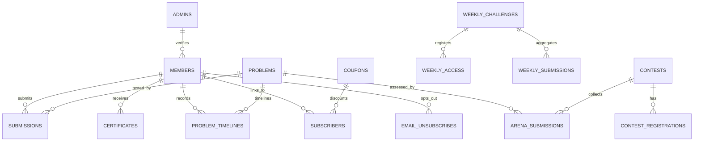

# BitByBit — Supabase Database Schema & RLS Specification

> **Specification Version:** 1.0.0  
> **Target Directory:** `.agent/02-database-schema.md`  
> **Source of Truth:** `supabase/migrations/*.sql`, `src/types/database.ts`, `docs/04-data-model.md`

---

## 1. Relational Architecture Diagram



---

## 2. Table Specifications & Column Definitions

### 1. `admins`
Table of GitHub user handles granted administrative rights.
- `github` (TEXT, PK): GitHub username of the admin.

### 2. `members`
Core user identity and leaderboard stats.
- `id` (UUID, PK, `gen_random_uuid()`): Unique member identifier.
- `github` (TEXT, UNIQUE, NOT NULL): GitHub username (from OAuth metadata).
- `name` (TEXT, NOT NULL): Full display name.
- `email` (TEXT, NULLABLE): Contact email address.
- `email_subscribed` (BOOLEAN, NOT NULL, DEFAULT true): Marketing/promotional email opt-in flag.
- `total_points` (INTEGER, NOT NULL, DEFAULT 0): Cumulative points earned.
- `problems_solved` (INTEGER, NOT NULL, DEFAULT 0): Count of unique solved problems.
- `streak` (INTEGER, NOT NULL, DEFAULT 0): Consecutive daily solve streak.
- `last_solved_at` (TIMESTAMPTZ, NULLABLE): Timestamp of most recent solve.
- `created_at` (TIMESTAMPTZ, NOT NULL, DEFAULT now()).
- *Indexes:* `idx_members_email_subscribed` on `(email, email_subscribed)`.

### 3. `problems`
Problem catalog and testing definitions.
- `id` (UUID, PK, `gen_random_uuid()`): Problem identifier.
- `title` (TEXT, NOT NULL): Problem title.
- `difficulty` (TEXT, NOT NULL): Check constraint `('Easy', 'Medium', 'Hard')`.
- `points` (INTEGER, NOT NULL): Point award upon completion.
- `tags` (TEXT[], NOT NULL, DEFAULT '{}'): Array of categorization tags.
- `description` (TEXT, NOT NULL): Markdown problem description.
- `example` (TEXT, NOT NULL): Example inputs and outputs.
- `starter_code` (TEXT, NOT NULL): Python function signature template.
- `param_types` (TEXT[], NOT NULL): Parameter type descriptors (e.g. `['int[]', 'int']`).
- `return_type` (TEXT, NOT NULL): Return type descriptor (e.g. `'int[]'`).
- `test_cases` (JSONB, NOT NULL, DEFAULT '[]'): Array of `{ input: string, expected: string, is_hidden?: boolean, explanation?: string }`.
- `hints` (TEXT[], DEFAULT '{}'): Optional sequential hints.
- `submission_count` (INTEGER, NOT NULL, DEFAULT 0): Global submission count.
- `is_contest_problem` (BOOLEAN, DEFAULT false): Problem restricted to live contest.
- `visibility` (TEXT, DEFAULT 'public'): `('public', 'arena', 'weekly')`.
- `created_at`, `updated_at` (TIMESTAMPTZ, DEFAULT now()).

### 4. `submissions`
Standard problem submission log.
- `id` (UUID, PK, `gen_random_uuid()`).
- `problem_id` (UUID, FK -> `problems.id`).
- `problem_title` (TEXT, NOT NULL).
- `github` (TEXT, NOT NULL).
- `name` (TEXT, NOT NULL).
- `lang` (TEXT, NOT NULL): Language key (`python`, `javascript`, `cpp`, `java`, `rust`, `go`).
- `code` (TEXT, NOT NULL): Submitted source code.
- `approach` (TEXT, NOT NULL): Candidate's stated strategy.
- `status` (TEXT, NOT NULL): `('pending', 'approved', 'rejected')`.
- `tests_passed` (INTEGER, NOT NULL).
- `tests_total` (INTEGER, NOT NULL).
- `points_awarded` (INTEGER, NOT NULL, DEFAULT 0).
- `reject_reason` (TEXT, NULLABLE).
- `created_at` (TIMESTAMPTZ, DEFAULT now()).

### 5. `contests`
Proctored arena competition configurations.
- `id` (UUID, PK, `gen_random_uuid()`).
- `name` (TEXT, NOT NULL).
- `entry_fee` (INTEGER, NOT NULL, DEFAULT 0).
- `duration_mins` (INTEGER, NOT NULL, DEFAULT 60).
- `upi_id` (TEXT, NOT NULL).
- `leaderboard_discount` (INTEGER, NOT NULL, DEFAULT 0).
- `problem_id` (UUID, NULLABLE, FK -> `problems.id`).
- `problem_ids` (UUID[], DEFAULT '{}').
- `status` (TEXT, NOT NULL): `('upcoming', 'live', 'ended')`.
- `starts_at` (TIMESTAMPTZ, NULLABLE).
- `created_at` (TIMESTAMPTZ, DEFAULT now()).

### 6. `contest_registrations`
User registration and ticket entries for contests.
- `id` (UUID, PK, `gen_random_uuid()`).
- `contest_id` (UUID, NOT NULL, FK -> `contests.id`).
- `contest_name` (TEXT, NOT NULL).
- `github` (TEXT, NOT NULL).
- `name` (TEXT, NOT NULL).
- `txn_id` (TEXT, NULLABLE).
- `razorpay_order_id`, `razorpay_payment_id` (TEXT, NULLABLE).
- `status` (TEXT, NOT NULL): `('pending', 'confirmed', 'rejected')`.
- `created_at` (TIMESTAMPTZ, DEFAULT now()).

### 7. `arena_submissions`
Competitive arena submissions with anti-cheat penalties.
- `id` (UUID, PK, `gen_random_uuid()`).
- `contest_id` (UUID, NULLABLE).
- `contest_name` (TEXT, NOT NULL).
- `problem_id` (UUID, NULLABLE).
- `problem_title` (TEXT, NOT NULL).
- `github`, `name` (TEXT, NOT NULL).
- `lang`, `code` (TEXT, NOT NULL).
- `strikes` (INTEGER, NOT NULL, DEFAULT 0): Anti-cheat strike counter.
- `status` (TEXT, NOT NULL): `('submitted', 'disqualified', 'reviewed')`.
- `strike_penalty_factor` (DOUBLE PRECISION, NOT NULL, DEFAULT 1.0): Multiplier based on strikes.
- `points_awarded` (INTEGER, NOT NULL, DEFAULT 0).
- `tests_passed`, `tests_total` (INTEGER, NOT NULL).
- `created_at` (TIMESTAMPTZ, DEFAULT now()).

### 8. `coupons` *(Migration: `20261008_coupons_schema.sql`)*
Promo code discount overrides.
- `id` (UUID, PK, `gen_random_uuid()`).
- `code` (TEXT, UNIQUE, NOT NULL, CHECK: `code = upper(code)`).
- `discount_type` (TEXT, NOT NULL, DEFAULT 'fixed', CHECK: `('fixed', 'percentage')`).
- `discount_value` (NUMERIC, NOT NULL, DEFAULT 160, CHECK: `>= 0`).
- `is_active` (BOOLEAN, NOT NULL, DEFAULT true).
- `created_at` (TIMESTAMPTZ, DEFAULT now()).
- *Indexes:* `idx_coupons_code` on `(code)`.
- *Seeded Defaults:* `BITBYBIT160` (fixed 160 off), `SAVE160` (fixed 160 off).

### 9. `subscribers`
Monthly recurring membership and subscription status.
- `id` (UUID, PK, `gen_random_uuid()`).
- `github` (TEXT, UNIQUE, NOT NULL).
- `name` (TEXT, NOT NULL).
- `txn_id` (TEXT, NOT NULL).
- `razorpay_order_id`, `razorpay_payment_id` (TEXT, NULLABLE).
- `email` (TEXT, NULLABLE).
- `email_subscribed` (BOOLEAN, NOT NULL, DEFAULT true).
- `status` (TEXT, NOT NULL): `('pending', 'confirmed', 'rejected')`.
- `current_period_end` (TIMESTAMPTZ, NULLABLE): End date of paid subscription month. Early renewal stacks additional days.
- `created_at` (TIMESTAMPTZ, DEFAULT now()).
- *Indexes:* `idx_subscribers_email_subscribed` on `(email, email_subscribed)`.

### 10. `email_unsubscribes` *(Migration: `20261013_email_unsubscribe_schema.sql`)*
Immutable audit log of user marketing opt-outs.
- `id` (UUID, PK, `gen_random_uuid()`).
- `email` (TEXT, UNIQUE, NOT NULL).
- `reason` (TEXT, NULLABLE).
- `source` (TEXT, DEFAULT 'unsubscribe_page').
- `unsubscribed_at`, `created_at` (TIMESTAMPTZ, DEFAULT now()).
- *Indexes:* `idx_email_unsubscribes_email` on `(email)`.

### 11. `problem_timelines` *(Migration: `20261015_problem_timelines_schema.sql`)*
Algorithmic thought-process time-lapse micro-snapshots.
- `id` (UUID, PK, `gen_random_uuid()`).
- `user_id` (UUID, NULLABLE, FK -> `members.id` ON DELETE SET NULL).
- `problem_id` (TEXT, NOT NULL).
- `problem_title` (TEXT, NULLABLE).
- `user_github` (TEXT, NULLABLE).
- `user_name` (TEXT, NULLABLE).
- `snapshots` (JSONB, NOT NULL, DEFAULT '[]'): Array of `{ timestamp, code, language, activeTestsPassed, eventType, stats, label }`.
- `duration_seconds` (INTEGER, DEFAULT 0).
- `created_at` (TIMESTAMPTZ, DEFAULT now()).
- *Indexes:* `idx_problem_timelines_problem_id`, `idx_problem_timelines_user_id`, `idx_problem_timelines_user_github`, `idx_problem_timelines_created_at`.

### 12. `certificates` *(Migration: `20261001_certificates_schema.sql`)*
Cryptographically verifiable achievement credentials.
- `id` (UUID, PK, `gen_random_uuid()`).
- `certificate_id` (TEXT, UNIQUE, NOT NULL).
- `member_id` (UUID, NULLABLE, FK -> `members.id` ON DELETE SET NULL).
- `github`, `recipient_name`, `recipient_email` (TEXT, NOT NULL).
- `certificate_type`, `title`, `achievement_text`, `event_name` (TEXT, NOT NULL).
- `organization_text`, `activity_points_text` (TEXT, DEFAULT text).
- `coordinator_names` (JSONB, DEFAULT coordinators array).
- `issued_at`, `issued_by`, `pdf_path` (TEXT, NOT NULL).
- `status` (TEXT, DEFAULT 'issued', CHECK: `('issued', 'revoked')`).
- `email_status` (TEXT, DEFAULT 'pending', CHECK: `('pending', 'sent', 'failed')`).
- `email_error` (TEXT, NULLABLE).
- `created_at`, `updated_at` (TIMESTAMPTZ, DEFAULT now()).
- *Indexes:* `idx_certificates_github`, `idx_certificates_cert_id`, `idx_certificates_status`, `idx_certificates_created_at`.

### 13. `collaborations_page` *(Migration: `20261006_collaborations_schema.sql`)*
Dedicated isolated CMS table for university and club partnerships.
- `id` (UUID, PK, `gen_random_uuid()`).
- `title` (TEXT, NOT NULL, DEFAULT 'Our Collaborations').
- `content` (TEXT, NOT NULL).
- `updated_at` (TIMESTAMPTZ, DEFAULT now()).

### 14. `weekly_challenges`, `weekly_access`, `weekly_submissions`
Weekly challenge grouping and submissions.
- `weekly_challenges`: `id`, `title`, `description`, `problem_ids`, `entry_fee`, `upi_id`, `whatsapp_link`, `starts_at`, `ends_at`, `status`, `created_at`.
- `weekly_access`: `id`, `weekly_challenge_id`, `weekly_challenge_title`, `github`, `name`, `txn_id`, `status`, `created_at`.
- `weekly_submissions`: `id`, `weekly_challenge_id`, `problem_id`, `problem_title`, `github`, `name`, `lang`, `code`, `tests_passed`, `tests_total`, `points_awarded`, `submitted_at`, `created_at`.

### 15. `ai_usage` & `app_config`
Usage quotas and global application key-value configuration.
- `ai_usage`: `github`, `date`, `feature`, `problem_id`, `used`, `last_used_at`.
### 16. `code_duels` *(Migration: `20261016_code_duels_schema.sql`)*
Real-time 1v1 code combat matches.
- `id` (UUID, PK, `gen_random_uuid()`).
- `problem_id` (TEXT, NOT NULL): Problem ID.
- `problem_title` (TEXT, NULLABLE).
- `time_limit_mins` (INTEGER, NOT NULL, DEFAULT 30).
- `host_id` (UUID, FK -> `members.id`).
- `host_github`, `host_name` (TEXT, NOT NULL).
- `guest_id` (UUID, NULLABLE, FK -> `members.id`).
- `guest_github`, `guest_name` (TEXT, NULLABLE).
- `status` (TEXT, NOT NULL, DEFAULT 'waiting', CHECK: `('waiting', 'active', 'completed', 'abandoned')`).
- `host_progress` (JSONB, NOT NULL, DEFAULT `{"testsPassed": 0, "totalTests": 0, "status": "coding"}`).
- `guest_progress` (JSONB, NOT NULL, DEFAULT `{"testsPassed": 0, "totalTests": 0, "status": "waiting"}`).
- `winner_id` (UUID, NULLABLE), `winner_github` (TEXT, NULLABLE).
- `started_at`, `ended_at` (TIMESTAMPTZ, NULLABLE).
- `created_at` (TIMESTAMPTZ, DEFAULT now()).
- *Indexes:* `idx_code_duels_host_id`, `idx_code_duels_guest_id`, `idx_code_duels_status`, `idx_code_duels_created_at`.
- *Realtime Enabled:* `ALTER PUBLICATION supabase_realtime ADD TABLE public.code_duels;` with `REPLICA IDENTITY FULL`.

---

## 3. Row Level Security (RLS) Policy Matrix

### Helper Function
```sql
CREATE OR REPLACE FUNCTION public.is_admin()
RETURNS BOOLEAN AS $$
BEGIN
  RETURN EXISTS (
    SELECT 1 FROM public.admins
    WHERE github = (auth.jwt() -> 'user_metadata' ->> 'user_name')
  );
END;
$$ LANGUAGE plpgsql SECURITY DEFINER;
```

### Table Security Rules

| Table | SELECT Policy | INSERT Policy | UPDATE Policy | DELETE Policy |
| :--- | :--- | :--- | :--- | :--- |
| **`code_duels`** | Public read (`true`) | Anon & Auth can create (`true`) | Participants can update progress (`true`) | Service role only |
| **`certificates`** | Public verify (`true`), Own certs (`github = user_name`), Admins (`is_admin()`) | Admin only (`is_admin()`) | Admin only (`is_admin()`) | Service role |
| **`collaborations_page`** | Public (`true`) | Admin only (`is_admin()`) | Admin only (`is_admin()`) | Admin only (`is_admin()`) |
| **`coupons`** | Public (`is_active = true`) | Admin only (`is_admin()`) | Admin only (`is_admin()`) | Admin only (`is_admin()`) |
| **`email_unsubscribes`**| Public / Anon (`true`) | Public / Anon (`true`) | Service role only | Service role only |
| **`problem_timelines`** | Public shared replays (`true`) | Anon & Auth workspace users (`true`) | Anon & Auth update own (`true`) | Service role only |
| **`subscribers`** | Own subscriber row (`github = user_name`), Admin | Service role only (Server action / webhook) | Service role only | Service role only |
| **`members`** | Public leaderboard (`true`) | Service role & Auth signup | Own record update | Service role |
| **`submissions`** | Public feed & own submissions | Authenticated users | Admin only | Service role |
