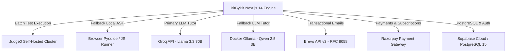

# BitByBit — Backend APIs, Server Actions & Integrations

> **Specification Version:** 1.0.0  
> **Target Directory:** `.agent/03-backend-apis-actions.md`  
> **Source of Truth:** `src/app/actions/*`, `src/app/api/*`, `src/lib/executor.ts`, `src/lib/email.ts`, `src/lib/gemini.ts`

---

## 1. Server Actions ("use server")

Next.js Server Actions execute in a secure Node.js environment with direct access to Supabase service-role credentials and server environment variables.

### 1. `src/app/actions/coupons.ts`
Manages promotional coupons and price overrides.
- `validateCouponAction(rawCode: string, basePrice: number = 199): Promise<CouponValidationResponse>`
  - Sanitizes and uppercases input code.
  - Queries active coupon from `coupons` table.
  - Computes exact discount (`percentage` or `fixed`).
  - Returns calculated `finalPrice`, `discountAmount`, and validated `coupon` metadata.
- `getCouponsAction(): Promise<{ success: boolean; coupons?: Coupon[]; error?: string }>`
  - Admin function fetching all coupons ordered by `created_at DESC`.
- `createCouponAction(input: CreateCouponInput): Promise<{ success: boolean; coupon?: Coupon; error?: string }>`
  - Enforces uppercase alphanumeric format regex (`/^[A-Z0-9_-]+$/`).
  - Enforces valid discount values (percentage capped at 100%).
  - Handles Postgres unique constraint error `23505`.
- `toggleCouponActiveAction(id: string, isActive: boolean): Promise<{ success: boolean; error?: string }>`
  - Updates coupon status without destroying historic checkout linkages.
- `deleteCouponAction(id: string): Promise<{ success: boolean; error?: string }>`
  - Permanently deletes coupon by ID.

### 2. `src/app/actions/unsubscribe.ts`
Handles email preferences and legal opt-out syncing.
- `unsubscribeEmailAction(rawEmail: string, reason?: string): Promise<UnsubscribeResponse>`
  - Sanitizes email with standard RFC email regex.
  - Atomically sets `email_subscribed = false` in `members` table.
  - Sets `email_subscribed = false` in `subscribers` table.
  - Upserts record in `email_unsubscribes` audit table (`onConflict: 'email'`).
- `resubscribeEmailAction(rawEmail: string): Promise<UnsubscribeResponse>`
  - Allows accidental unsubscribers to re-enable notifications.
  - Sets `email_subscribed = true` in `members` and `subscribers`.
  - Removes record from `email_unsubscribes`.
- `checkEmailSubscriptionStatusAction(rawEmail: string): Promise<UnsubscribeResponse>`
  - Checks multi-table subscription status via `isEmailSubscribed()`.

### 3. `src/app/actions/duels.ts`
Real-time 1v1 Code Duel combat and telemetry synchronization.
- `createDuelAction(input: CreateDuelInput): Promise<{ success: boolean; duel?: CodeDuel; duelId?: string; error?: string }>`
  - Validates problem_id, host credentials, generates room with status `'waiting'`, and initializes telemetry.
- `getDuelAction(roomId: string): Promise<{ success: boolean; duel?: CodeDuel; error?: string }>`
  - Loads duel room state and problem linkage.
- `joinDuelAction(roomId: string, guestGithub: string, guestName: string): Promise<{ success: boolean; duel?: CodeDuel; error?: string }>`
  - Assigns guest participant, transitions status to `'active'`, and initializes synchronized countdown timer.
- `updateDuelProgressAction(roomId: string, userGithub: string, progress: Partial<DuelProgress>): Promise<{ success: boolean; duel?: CodeDuel; isVictory?: boolean; error?: string }>`
  - Updates tests passed/total and combat status (`coding`, `running_tests`, `submitted`).
  - Automatically declares victory upon 100% test completion and sets status to `'completed'`.
  - **Zero Code Leaks:** Never broadcasts raw code lines; transmits only numerical metrics and status flags.
- `forfeitDuelAction(roomId: string, concedingGithub: string): Promise<{ success: boolean; error?: string }>`
  - Concedes match and awards victory to the remaining player.

---

## 2. Server API Routes (`/api/*`)

### 1. Code Execution (`POST /api/execute`)
- **Isolation & Test Authoritativeness:**
  - If `problem_id` is supplied, fetches authoritative test cases from Supabase server-side.
  - In `mode: 'run'`, evaluates against non-hidden sample test cases.
  - In `mode: 'submit'`, evaluates against **all** test cases (visible + hidden).
  - Sanitizes hidden test cases before JSON response: `input`, `expected`, and `actual` are replaced with `"[Hidden]"` to prevent network sniffing or LeetCode scraping attacks.
- **Languages:** Python, JavaScript, C++, Java, Go, Rust.
- **Backend:** Calls `runAgainstTestCases()` in `src/lib/executor.ts` (Judge0 batch runner).

### 2. RFC 8058 Email Unsubscribe (`GET` & `POST /api/unsubscribe`)
- **RFC 8058 Compliance:** Supports automated one-click unsubscribes from email clients (Gmail, Apple Mail) and direct web links.
- **POST Handler:**
  - Accepts `application/json`, `application/x-www-form-urlencoded` (RFC 8058 standard POST body), or query parameters.
  - Supports actions: `'unsubscribe'` (default) or `'resubscribe'`.
- **GET Handler:**
  - Returns `{ success: true, email, email_subscribed }` for real-time frontend status verification.

### 3. Razorpay Payment Gateway (`/api/razorpay/*`)
- **`POST /api/razorpay/create-order`:**
  - Cryptographically verifies user identity from Supabase Auth access token (`Authorization: Bearer <token>`).
  - Resolves base price from `app_config` (`key: 'subscription_fee'`, default 199).
  - Checks and validates optional `couponCode` server-side against `coupons` table.
  - Issues Razorpay order with currency `'INR'`, amount in paise (`Math.round(finalAmount * 100)`), and audit metadata in `notes`.
- **`POST /api/razorpay/verify`:**
  - Verifies payment signature using HMAC SHA256 of `${order_id}|${payment_id}` with `RAZORPAY_KEY_SECRET`.
  - Updates `subscribers` table status to `'confirmed'`.
  - Calculates subscription period: stacks +30 days on top of existing `current_period_end` if active, or `now + 30 days` if new/expired.
- **`POST /api/razorpay/webhook`:**
  - Handles asynchronous payment success events (`payment.captured`, `order.paid`).

### 4. Algorithmic Replay & Timelines (`/api/timeline/*`)
- **`POST /api/timeline/save`:**
  - Ingests workspace session recordings: `{ problem_id, problem_title, user_github, snapshots, duration_seconds }`.
  - Resolves `user_id` from `members` table where available.
  - Inserts into `problem_timelines` table and returns UUID.
- **`GET /api/timeline/[id]`:**
  - Public endpoint retrieving recorded timeline snapshots and duration for replay playback.

### 5. AI Tutoring Engine (`POST /api/ai`)
- **Groq Primary Integration:**
  - Model: `llama-3.3-70b-versatile` (configurable via `GROQ_MODEL`).
  - Strict abort timeout controller (`12000ms`).
  - Handles rate limits (`429 GROQ_RATE_LIMIT`) with graceful fallback to Ollama.
- **Ollama Local Fallback:**
  - Self-hosted fallback runner (`http://localhost:11434`, model `qwen2.5-coder:3b`).
- **Quota & Protection:**
  - Enforced per-user quotas stored in `ai_usage` table. Requires active subscription.

### 6. Certificates & Verification (`/api/certificates/*`)
- **`POST /api/certificates/generate`:**
  - Admin endpoint generating vectorized achievement certificates with member details and coordinator credentials.
- **`GET /api/certificates/verify`:**
  - Public lookup returning verifiable status, recipient name, and activity points validity.

---

## 3. Third-Party Integrations & External Clients

### Brevo Email Integration (`src/lib/email.ts`)
- **Endpoint:** `https://api.brevo.com/v3/smtp/email`
- **Pre-Send Opt-Out Check:** `isEmailSubscribed(to)` verifies status against `email_unsubscribes`, `members`, and `subscribers` before transmitting marketing emails.
- **Mandatory Unsubscribe Injection:** Appends compliant unsubscribe link to all promotional emails:
  `${UNSUBSCRIBE_BASE_URL}?email=${encodeURIComponent(email)}`
- **Email Wrappers:** Consistent Dark Mode branded HTML template (`#0a0a0a` background, `#111` card, `#00e87a` brand accent).

### Judge0 Multi-Language Execution (`src/lib/executor.ts`)
- **LeetCode-Style Native Harness:**
  - User functions receive real language types (`int[]`, `std::vector<int>`, `String`, `[]int`, `Vec<i32>`).
  - Arguments are injected as native source literals at build time (avoiding runtime JSON overhead).
  - Return values are serialized using language stdlib only (e.g. `encoding/json` in Go, custom vector serializers in C++).
- **Execution Batching:**
  - All test cases are bundled into a single compiled binary loop.
  - Outputs are delimited by a unique sentinel string (`---CASE---`) and parsed into discrete test results.
- **C++ Scope Isolation:**
  - Each generated test case is enclosed within its own `{ }` scope block to prevent variable shadowing and `auto __r__` symbol collisions.
