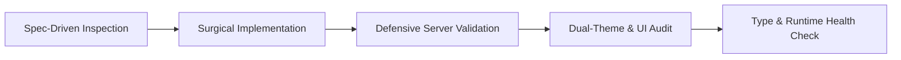
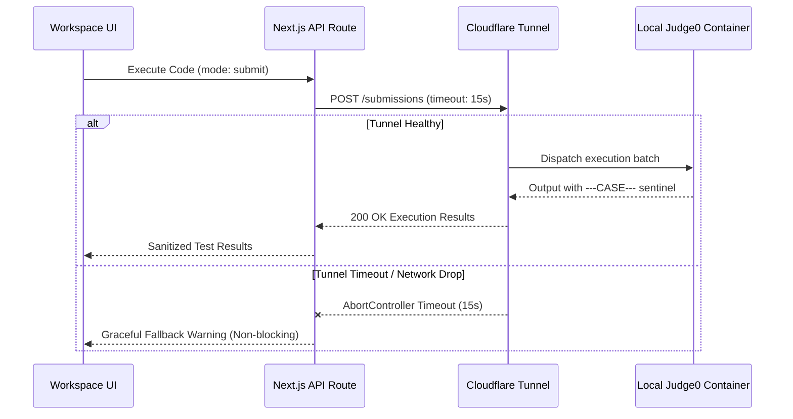

# BitByBit — Testing, Refactoring & Verification Protocol

> **Specification Version:** 1.0.0  
> **Target Directory:** `.agent/05-testing-refactoring-protocol.md`  
> **Status:** Mandatory Quality Assurance & Code Hygiene Directives

---

## 1. Overview & Verification Philosophy

To maintain BitByBit as a high-security, ultra-responsive competitive programming engine, every code change, migration, or refactoring pass must be verified through this protocol before delivery.



---

## 2. Defensive Server-Side Testing & Verification

Every API route and `"use server"` action must be defensively fortified against malicious payloads, network inspection leaks, and identity spoofing:

### 1. Pricing & Coupon Validation Testing
- **Zero Client Trust:** Test that passing arbitrary `basePrice` or `finalPrice` from client request bodies does not influence Razorpay order creation. The amount must always be resolved from database `app_config` and `coupons`.
- **Negative & Malformed Values:** Test coupon inputs with:
  - Empty strings, whitespace, lowercase codes (`save160` -> auto-uppercased to `SAVE160`).
  - Special characters or SQL injection attempts (`' OR '1'='1`).
  - Boundary percentages (> 100% discount rejected).
  - Deactivated or expired coupons (must return `{ valid: false, error: "Coupon code is inactive or expired." }`).
- **Paise Precision:** Confirm currency math uses `Math.round(finalAmount * 100)` without floating-point drift.

### 2. RFC 8058 Email Unsubscribe Verification
- **Multi-Table Consistency:** Verify that executing an unsubscribe updates all 3 database destinations:
  1. `members.email_subscribed` set to `false`.
  2. `subscribers.email_subscribed` set to `false`.
  3. `email_unsubscribes` receives an audit row with timestamp and reason.
- **Pre-Send Opt-Out Enforcement:** Verify that `sendEmail()` with `isPromotional: true` aborts dispatches if `isEmailSubscribed(to)` resolves to `false`.
- **Payload Formats:** Test `/api/unsubscribe` against:
  - `application/json` (`{ "email": "user@example.com" }`).
  - `application/x-www-form-urlencoded` (`email=user%40example.com`).
  - URL Query parameters (`?email=user@example.com`).

### 3. Execution Engine & Hidden Test Case Quarantine
- **Sanitization Leak Test:** Inspect JSON response from `POST /api/execute` in `mode: 'submit'`:
  - `input`, `expected`, and `actual` for test cases marked `is_hidden: true` must strictly be replaced with `"[Hidden]"`.
  - Only boolean `ok`, execution `time`, and sanitized status may be returned.
- **Execution Timeout Handling:** Verify that infinite loops or CPU exhaustion in user code trigger Judge0/runner timeouts without crashing the Next.js process.
- **C++ Scope Clashes:** Verify multi-case test batches compile without `conflicting declaration 'auto __r__'` errors by ensuring each case is wrapped in an isolated `{ }` block.

---

## 3. UI, Theme & Performance State Validation

### 1. Dual-Theme Visual & Contrast Audits
- **Zero Hardcoded Color Leaks:** Never use hardcoded Tailwind classes like `text-white`, `text-black`, `bg-gray-100`, or `bg-zinc-900` on general surfaces without paired dark variants (e.g., use `text-text`, `bg-bg`, `border-border` or explicit `text-slate-900 dark:text-slate-100`).
- **Theme Transition Flashes:** Ensure theme switches between `[data-theme='light']` and `[data-theme='dark']` do not cause layout shifts or SSR hydration warnings.
- **Monaco Theme Synchronization:** Confirm Monaco editor automatically flips between `vs` and `vs-dark` when toggling theme via the TopBar switch.

### 2. Dynamic Import & Performance Budgets
- **Client-Side Heavyweights:** Verify heavy interactive components are imported dynamically with `ssr: false`:
  ```tsx
  import dynamic from "next/dynamic";
  
  const CodeEditor = dynamic(() => import("@/components/code-editor/CodeEditor"), {
    ssr: false,
    loading: () => <EditorSkeleton />,
  });
  
  const LogicVisualizer = dynamic(() => import("@/components/code-editor/LogicVisualizerDrawer"), {
    ssr: false,
  });
  
  const ReplayPlayer = dynamic(() => import("@/components/workspace/ReplayPlayer"), {
    ssr: false,
  });
  ```
- **Re-render Prevention in Workspace Loops:**
  - Wrap high-frequency handlers (`onChange`, `onRun`, `onSubmit`) in `useCallback` or `useRef`.
  - Avoid putting high-frequency character edit states into global `AppShellContext`. Keep typing state local to the editor workspace.

---

## 4. Local Service Resilience (Judge0 & Ollama via Tunnel)

When testing against containerized local instances exposed through Cloudflare Tunnels:



### Resilience Checks:
1. **Network Drop Simulation:** Simulate tunnel disconnection (`cloudflared` stopped or unreachable).
2. **Graceful Degradation:** The UI must display an informative toast or status alert ("Remote execution cluster temporarily unreachable. Retrying or switching to browser runner...") rather than unhandled promise rejections or white-screen crashes.
3. **AI Fallback Sequence:** Test that if Groq returns `429 GROQ_RATE_LIMIT` or encounters a timeout, the request automatically routes to `NEXT_PUBLIC_OLLAMA_URL` (`qwen2.5-coder:3b`).

---

## 5. Continuous Code Refactoring & Hygiene Guidelines

All development cycles must incorporate continuous refactoring rules:

1. **Strict TypeScript Typing (No `any`):**
   - Replace legacy `any` casts with explicit domain types from `@/types/database`, `@/types/coupons`, or `@/types/collaborations`.
   - Use `Record<string, unknown>` or generic parameters when dealing with arbitrary JSON payloads.
2. **Dead Code & Artifact Pruning:**
   - Remove unused imports, dead components, and obsolete console logs.
   - Clean up temporary local storage keys that do not adhere to `bb_*` naming conventions.
3. **Database Migration Immutability:**
   - **Rule:** Never alter an existing `.sql` migration file in `supabase/migrations/` that has already been deployed.
   - **Procedure:** Always generate a new timestamped file (e.g., `20261016_new_feature.sql`) and include accompanying RLS policies and index definitions.
4. **Automated Verification Command:**
   - Always run the TypeScript type checker to confirm zero compiler regressions:
     ```powershell
     powershell -Command "npx tsc --noEmit"
     ```
