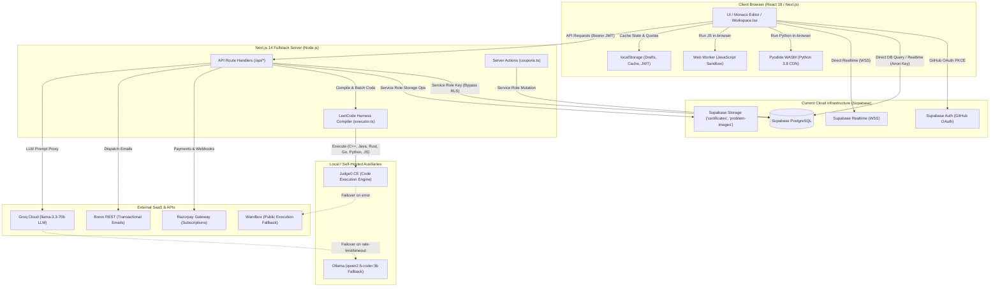
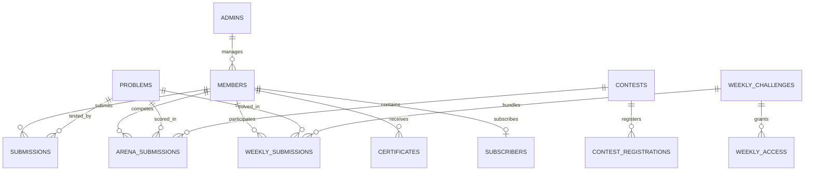
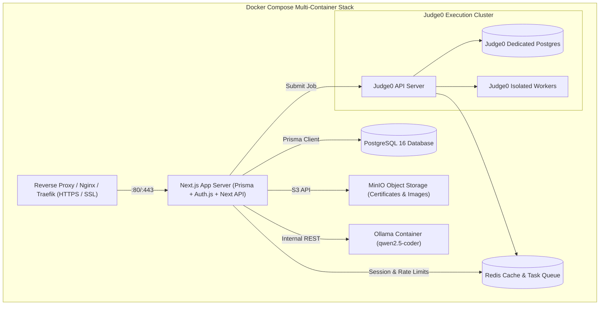

# BitByBit — Comprehensive System Architecture Audit

**Target Goal**: Full system discovery and specification to migrate BitByBit from a SaaS/serverless topology (Vercel, Supabase, Groq, Brevo, Razorpay, Wandbox, Pyodide CDN) to a **fully self-hosted, sovereign stack** (PostgreSQL + Prisma, Self-Hosted Judge0, Node.js/Next.js Docker container, local/self-hosted LLM, self-hosted SMTP/MinIO, and Docker Compose).

---

## 1. System Overview

### 1.1 Languages, Frameworks, and Tooling
* **Frontend**: Next.js 14.2.3 (React 18, App Router), TypeScript 5, Tailwind CSS 3.4.1, Lucide React icons, Monaco Editor (`@monaco-editor/react` 4.6.0).
* **Backend**: Next.js App Router Route Handlers (`src/app/api/`) and React Server Actions (`src/app/actions/`).
* **Database Client**: `@supabase/supabase-js` (v2.43.1) and `@supabase/ssr` (v0.3.0).
* **Package Manager**: `npm` (with root `package-lock.json`).
* **Runtime Quirks**: Windows / Node.js v24 filesystem patch (`patch-readlink.cjs` remapping `EISDIR` -> `EINVAL` for webpack's `enhanced-resolve` symlink checking).

### 1.2 Folder Structure
```
bit-by-bit-updated/
├── .env.example              # Environment variables template
├── next.config.mjs           # Next.js config, CSP headers, readlink patch
├── package.json              # App manifest & dependencies
├── patch-readlink.cjs        # Node v24 readlink hook for Windows
├── vercel.json               # Vercel Cron definitions (subscribe-nudge, prune)
├── public/                   # Static assets, certificate templates, local uploads
├── supabase/
│   └── migrations/           # Tracked SQL migrations (certificates, collabs, coupons)
├── docs/                     # Existing architecture and design notes
└── src/
    ├── app/
    │   ├── (app)/            # User-facing routes (problems, arena, leaderboard, weekly, subscribe, profile, admin)
    │   ├── actions/          # Server actions (coupons.ts)
    │   ├── api/              # 25 Route Handlers (auth, problems, execute, ai, razorpay, certificates, etc.)
    │   └── problems/         # Workspace.tsx (monolithic 1646-line editor/judging client)
    ├── components/           # React UI components (code-editor, arena, discussion, layout, pages)
    ├── lib/                  # Core domain logic (supabase, executor, browserExecutor, gemini, email, razorpay, visualizer)
    └── types/                # TypeScript schemas (database.ts, coupons.ts, collaborations.ts)
```

### 1.3 Frontend vs. Backend Communication
* **Client-to-Database**: The client browser communicates **directly** with Supabase PostgreSQL via `@supabase/supabase-js` using the public `NEXT_PUBLIC_SUPABASE_ANON_KEY` for read/write queries (problems list, leaderboard, member profile, and direct submission creation).
* **Client-to-Server**: Next.js Route Handlers (`/api/*`) are invoked via standard `fetch()` with an `Authorization: Bearer <Supabase-JWT>` header for sensitive operations (subscribing, executing code on server, issuing certificates, triggering email notifications).
* **Realtime**: Supabase Realtime (WebSockets over WSS) is configured for live contest and submission tracking.

### 1.4 Current Run, Build, and Deployment Topology
* **Development**: `npm run dev` executes `node -r ./patch-readlink.cjs ./node_modules/next/dist/bin/next dev`.
* **Production Build**: `npm run build` runs Next.js build without worker threads (`webpackBuildWorker: false`).
* **Hosting**: Hosted on **Vercel Serverless**. Background maintenance is driven by Vercel Cron via `vercel.json` (daily nudge at 09:00 UTC, weekly prune at 03:00 UTC Sunday).

---

## 2. System Architecture Diagram



---

## 3. Third-Party Services and Dependencies

| Service | Purpose | Files Using It | Environment Variables | Coupling Level | Suggested Self-Hosted Replacement | Migration Effort |
|---|---|---|---|---|---|---|
| **Supabase (PostgreSQL, Auth, Storage, Realtime)** | Relational DB, GitHub Auth, Certificate/Image object storage, Realtime updates | `src/lib/supabase.ts`, `src/app/api/*`, `src/app/actions/*`, `src/app/problems/Workspace.tsx`, all UI pages | `NEXT_PUBLIC_SUPABASE_URL`<br>`NEXT_PUBLIC_SUPABASE_ANON_KEY`<br>`SUPABASE_SERVICE_ROLE_KEY` | **High** (Scattered `.from()` calls across 20+ client and server files) | **PostgreSQL 16 + Prisma ORM + Lucia/Auth.js (or custom JWT) + MinIO + Redis Pub/Sub** | **High** |
| **Razorpay** | Subscription payments (₹39/month), order generation, webhook signature verification | `src/lib/razorpay.ts`<br>`src/app/api/razorpay/create-order/route.ts`<br>`src/app/api/razorpay/verify/route.ts`<br>`src/app/api/razorpay/webhook/route.ts` | `RAZORPAY_KEY_ID`<br>`RAZORPAY_KEY_SECRET`<br>`NEXT_PUBLIC_RAZORPAY_KEY_ID`<br>`RAZORPAY_WEBHOOK_SECRET`<br>`NEXT_PUBLIC_PAYMENTS_LIVE` | **Medium** (Isolated in `lib/razorpay.ts` and `api/razorpay/*`) | **Self-hosted payment gateway switch (e.g. Hyperswitch) or direct UPI / Stripe / Manual Admin Approval** | **Medium** |
| **Brevo (Sendinblue)** | Transactional emails (subscription receipts, contest alerts, certificate issuance, nudges) | `src/lib/email.ts`<br>`src/app/api/notify/*`<br>`src/app/api/certificates/*`<br>`src/app/api/admin/prune/route.ts` | `BREVO_API_KEY`<br>`BREVO_SENDER_EMAIL`<br>`BREVO_SENDER_NAME` | **Low** (Cleanly isolated in `src/lib/email.ts`) | **Nodemailer + Self-Hosted Postfix / Mailcow / Stalwart SMTP** | **Low** |
| **Groq Cloud API** | Primary LLM inference (`llama-3.3-70b-versatile`) for hints, reviews, editorials, explanations | `src/app/api/ai/route.ts`<br>`src/lib/gemini.ts` | `GROQ_API_KEY`<br>`GROQ_MODEL` | **Low** (Wrapped behind `/api/ai` and `src/lib/gemini.ts`) | **Self-Hosted Ollama / vLLM / LocalAI (`qwen2.5-coder:7b` or `llama-3.3-70b`)** | **Low** |
| **Ollama** | Fallback local LLM inference (`qwen2.5-coder:3b`) | `src/lib/gemini.ts` | `NEXT_PUBLIC_OLLAMA_URL`<br>`NEXT_PUBLIC_OLLAMA_MODEL` | **Low** (Fallback inside `callAI()` in `gemini.ts`) | **Retain Ollama container in Docker Compose** | **Low** |
| **Judge0 (CE)** | Server-side multi-language code compilation and sandbox execution | `src/lib/executor.ts`<br>`src/app/api/execute/route.ts`<br>`src/app/api/visualize/trace/route.ts` | `JUDGE0_URL`<br>`JUDGE0_AUTH_TOKEN` | **Low** (Encapsulated in `src/lib/executor.ts`) | **Self-Hosted Judge0 v1.13.1 + Redis + Postgres in Docker Compose** | **Low** |
| **Wandbox API** | Public code compilation API fallback when Judge0 fails | `src/lib/executor.ts` | None (Public endpoint `https://wandbox.org/api/compile.json`) | **Low** (Fallback in `executor.ts`) | **Remove completely** (Rely on redundant local Judge0 workers) | **Low** |
| **Pyodide CDN** | In-browser Python 3 WASM execution runtime | `src/lib/browserExecutor.ts`<br>`src/lib/visualizer.ts` | Loaded from `https://cdn.jsdelivr.net/pyodide/v0.26.1/full/` | **Medium** (Dynamic `<script>` tag injection) | **Serve Pyodide static assets from `/public/pyodide/` or execute Python in Judge0** | **Low** |
| **Vercel Analytics** | Real-user analytics & page tracking | `src/app/layout.tsx` | Implicit via Vercel | **Low** (Component import in root layout) | **Remove or replace with Umami / Plausible** | **Low** |
| **Vercel Cron** | Scheduled cron tasks (inactivity prune, subscription nudges) | `vercel.json`<br>`src/app/api/admin/prune/route.ts`<br>`src/app/api/notify/subscribe-nudge/route.ts` | `CRON_SECRET` | **Low** (Config in `vercel.json`, auth in headers) | **Node-cron / pg-boss / BullMQ / Linux systemd crontab** | **Low** |

---

## 4. Database Architecture & Entities

### 4.1 Storage Model
Current database is **PostgreSQL** hosted on Supabase.
* **Migration Reality**: Only 3 tables (`certificates`, `collaborations_page`, `coupons`) are managed via SQL files in `supabase/migrations/`. All other 15 tables were created manually in the Supabase web dashboard.
* **Query Patterns**: Data access is severely fragmented. Direct queries using the client SDK (`db.from('...')`) are scattered throughout React components, bypassing the backend API.

### 4.2 Entity Relationship & Schema Reference



#### Detailed Table Specifications

1. **`admins`**
   - Columns: `github` (TEXT, PK).
   - Relationship: Referenced by admin authorization checks.
2. **`members`**
   - Columns: `id` (UUID, PK), `github` (TEXT, UK), `name` (TEXT), `email` (TEXT, nullable), `total_points` (INT), `problems_solved` (INT), `streak` (INT), `last_solved_at` (TIMESTAMPTZ, nullable), `created_at` (TIMESTAMPTZ).
   - Relations: One-to-many with `submissions`, `certificates`.
3. **`problems`**
   - Columns: `id` (UUID, PK), `title` (TEXT), `difficulty` (TEXT: Easy/Medium/Hard), `points` (INT), `tags` (TEXT[]), `description` (TEXT), `example` (TEXT), `starter_code` (TEXT), `param_types` (TEXT[]), `return_type` (TEXT), `test_cases` (JSONB: array of `{input, expected, is_hidden, explanation}`), `hints` (TEXT[]), `submission_count` (INT), `is_contest_problem` (BOOLEAN), `visibility` (TEXT: public/arena/weekly), `created_at` (TIMESTAMPTZ), `updated_at` (TIMESTAMPTZ).
4. **`submissions`**
   - Columns: `id` (UUID, PK), `problem_id` (UUID, FK -> problems.id), `problem_title` (TEXT), `github` (TEXT), `name` (TEXT), `lang` (TEXT), `code` (TEXT), `approach` (TEXT), `status` (TEXT: pending/approved/rejected), `tests_passed` (INT), `tests_total` (INT), `points_awarded` (INT), `reject_reason` (TEXT, nullable), `created_at` (TIMESTAMPTZ).
   - Unique Constraint: `(problem_id, github)`.
5. **`contests`**
   - Columns: `id` (UUID, PK), `name` (TEXT), `entry_fee` (INT), `duration_mins` (INT), `upi_id` (TEXT), `leaderboard_discount` (INT), `problem_id` (UUID, nullable), `problem_ids` (UUID[]), `status` (TEXT: upcoming/live/ended), `starts_at` (TIMESTAMPTZ, nullable), `created_at` (TIMESTAMPTZ).
6. **`contest_registrations`**
   - Columns: `id` (UUID, PK), `contest_id` (UUID, FK -> contests.id), `contest_name` (TEXT), `github` (TEXT), `name` (TEXT), `txn_id` (TEXT, nullable), `razorpay_order_id` (TEXT, nullable), `razorpay_payment_id` (TEXT, nullable), `status` (TEXT: pending/confirmed/rejected), `created_at` (TIMESTAMPTZ).
7. **`arena_submissions`**
   - Columns: `id` (UUID, PK), `contest_id` (UUID, FK -> contests.id), `contest_name` (TEXT), `problem_id` (UUID, FK -> problems.id), `problem_title` (TEXT), `github` (TEXT), `name` (TEXT), `lang` (TEXT), `code` (TEXT), `strikes` (INT), `status` (TEXT: submitted/disqualified/reviewed), `strike_penalty_factor` (FLOAT), `points_awarded` (INT), `tests_passed` (INT), `tests_total` (INT), `created_at` (TIMESTAMPTZ).
   - Unique Constraint: `(contest_id, problem_id, github)`.
8. **`subscribers`**
   - Columns: `id` (UUID, PK), `github` (TEXT, UK), `name` (TEXT), `txn_id` (TEXT, nullable), `razorpay_order_id` (TEXT, nullable), `razorpay_payment_id` (TEXT, nullable), `email` (TEXT), `status` (TEXT: active/confirmed/pending), `current_period_end` (TIMESTAMPTZ), `created_at` (TIMESTAMPTZ).
9. **`weekly_challenges`**
   - Columns: `id` (UUID, PK), `title` (TEXT), `description` (TEXT), `problem_ids` (UUID[]), `entry_fee` (INT), `upi_id` (TEXT), `whatsapp_link` (TEXT, nullable), `starts_at` (TIMESTAMPTZ), `ends_at` (TIMESTAMPTZ), `status` (TEXT), `created_at` (TIMESTAMPTZ).
10. **`weekly_access`**
    - Columns: `id` (UUID, PK), `weekly_challenge_id` (UUID, FK -> weekly_challenges.id), `weekly_challenge_title` (TEXT), `github` (TEXT), `name` (TEXT), `txn_id` (TEXT, nullable), `status` (TEXT), `created_at` (TIMESTAMPTZ).
11. **`weekly_submissions`**
    - Columns: `id` (UUID, PK), `weekly_challenge_id` (UUID, FK -> weekly_challenges.id), `problem_id` (UUID, FK -> problems.id), `problem_title` (TEXT), `github` (TEXT), `name` (TEXT), `lang` (TEXT), `code` (TEXT), `status` (TEXT: pending/approved), `tests_passed` (INT), `tests_total` (INT), `points_awarded` (INT), `submitted_at` (TIMESTAMPTZ), `created_at` (TIMESTAMPTZ).
12. **`certificates`**
    - Columns: `id` (UUID, PK), `certificate_id` (TEXT, UK), `member_id` (UUID, FK -> members.id), `github` (TEXT), `recipient_name` (TEXT), `recipient_email` (TEXT), `certificate_type` (TEXT), `title` (TEXT), `achievement_text` (TEXT), `event_name` (TEXT), `organization_text` (TEXT), `activity_points_text` (TEXT, nullable), `coordinator_names` (JSONB), `issued_at` (TIMESTAMPTZ), `issued_by` (TEXT), `pdf_path` (TEXT), `status` (TEXT: issued/revoked), `email_status` (TEXT: pending/sent/failed), `email_error` (TEXT, nullable), `created_at` (TIMESTAMPTZ), `updated_at` (TIMESTAMPTZ).
13. **`email_log`**
    - Columns: `id` (UUID, PK), `github` (TEXT), `email` (TEXT), `kind` (TEXT), `ref_id` (TEXT), `sent_at` (TIMESTAMPTZ).
14. **`ai_usage`**
    - Columns: `github` (TEXT), `feature` / `action` (TEXT), `problem_id` (TEXT), `used` (INT), `date` (DATE), `last_used_at` (TIMESTAMPTZ).
15. **`practice_attempts`**
    - Columns: `id` (UUID, PK), `problem_id` (UUID, FK -> problems.id), `github` (TEXT), `name` (TEXT), `lang` (TEXT), `attempted_at` (TIMESTAMPTZ).
16. **`app_config`**
    - Columns: `key` (TEXT, PK), `value` (TEXT). Stores dynamic configs like `subscription_amount_paise`.
17. **`coupons`**
    - Columns: `id` (UUID, PK), `code` (TEXT, UK), `discount_type` (TEXT: fixed/percentage), `discount_value` (NUMERIC), `is_active` (BOOLEAN), `created_at` (TIMESTAMPTZ).
18. **`collaborations_page`**
    - Columns: `id` (UUID, PK), `title` (TEXT), `content` (TEXT), `updated_at` (TIMESTAMPTZ).

### 4.3 Real / Sensitive Data Present in Repository
* In `supabase/migrations/20261001_certificates_schema.sql`: Hardcoded names of college faculty coordinators (`PROF. NAMRATHA M.`, `PANNAG K`, `AAKANSHYA AGARWAL`).
* In `supabase/migrations/20261006_collaborations_schema.sql`: Real contact email (`teamcodelocked@gmail.com`).
* No live user accounts or customer records are checked into git.

---

## 5. Authentication, Authorization & Security Audit

### 5.1 Authentication Flow
1. User clicks **"Sign in with GitHub"**.
2. Client executes `supabase.auth.signInWithOAuth({ provider: 'github', flowType: 'implicit' })`.
3. Supabase redirects back with access token; client stores JWT in `localStorage` (`bitbybit-auth`).
4. Client fires `POST /api/auth/sync` with `Authorization: Bearer <JWT>`.
5. The `/api/auth/sync` endpoint validates the token against Supabase Auth, retrieves `user_metadata.user_name` and `email`, and upserts the `members` record using `SUPABASE_SERVICE_ROLE_KEY`.

### 5.2 Authorization Mechanisms
* **Admin Verification**: Handled via `getVerifiedAdmin(req)` across API routes. The route resolves the JWT, extracts `user_metadata.user_name`, and checks for an entry in `admins`.
* **Client Admin Cache**: `resolveAdminStatus(github)` in `src/lib/supabase.ts` caches admin status in `localStorage` for 1 hour (`bb_admin_<github>`).

---

## 6. Code Execution & Judging Pipeline

### 6.1 Language Execution Routing
* **In-Browser Execution** (`src/lib/browserExecutor.ts`):
  * **Python**: Runs in-browser via Pyodide WASM (`0.26.1`) loaded from jsDelivr CDN. User function is wrapped in a dynamic Python harness with `json.dumps`.
  * **JavaScript**: Runs in-browser inside a Web Worker. Wrapped in a try/catch string with `eval()` and terminated via `setTimeout(5000)`.
* **Server-Side Execution** (`src/lib/executor.ts`):
  * **C++, Java, Rust, Go**: Sent to `POST /api/execute`.
  * The backend builds a typed test harness (`src/lib/leetCodeHarness.ts` / `executor.ts`) embedding all test cases directly as native literals (preventing runtime JSON overhead) separated by sentinel `---CASE---`.
  * Submits batched program to **Judge0** (`JUDGE0_URL`) with `wait=true` (CPU limit: 10s, wall limit: 15s).
  * If Judge0 fails or is unreachable, falls back to **Wandbox** public REST API with 3 retries.

### 6.2 Submission Lifecycle
1. **User Action**: Clicks "Submit" in `Workspace.tsx`.
2. **Server Execution**: Frontend calls `POST /api/execute` with `{ problem_id, code, language, mode: 'submit' }`.
3. **Test Case Fetching**: Backend loads all test cases (both visible and hidden) directly from DB using service role client.
4. **Judging**: Runs code against the full suite on Judge0. Returns sanitized results where hidden test inputs/outputs are redacted to `[Hidden]`.
5. **Score Recording (Vulnerability)**: The client browser receives `{ passed, total }`, computes the points awarded, and **directly executes** `db.from('submissions').upsert(...)` and `syncMemberProgress(db, ...)` to award points and increment streak.

---

## 7. AI Capabilities

* **Underlying Architecture**: Defined in `src/lib/gemini.ts` (misleading legacy name) and proxied through `POST /api/ai` (`src/app/api/ai/route.ts`).
* **Model**: **Groq API** with `llama-3.3-70b-versatile` (Temperature: 0.2, Max Tokens: 1024).
* **Fallback**: Local **Ollama** server (`NEXT_PUBLIC_OLLAMA_URL`, model: `qwen2.5-coder:3b`).
* **Features**:
  1. `explainFailure`: Analyzes student code + failing test cases; provides 3-5 sentence explanation without spoiling solution.
  2. `getAiHint`: Progressive 3-tier hints per problem.
  3. `reviewCode`: Provides code quality, time/space complexity analysis.
  4. `validateApproach`: Verifies student algorithm before writing code.
  5. `generateEditorial`: Generates full optimal solution and complexity breakdown.
  6. `getRecommendations`: Suggests next problems based on solved history.
* **Quota Enforcement**: Daily limits (3 hints/problem, 5 explanations/day, 3 reviews/day) tracked in `ai_usage` table and cached in browser `localStorage`.

---

## 8. Security & Vulnerability Findings (Ranked by Severity)

### Critical Severity

1. **`CRIT-1`: Trivial Admin Authentication Bypass on Problem APIs (Hidden Test Case Leak)**
   * **Location**: `src/app/api/problems/route.ts:28` and `src/app/api/problems/[id]/route.ts:47`
   * **Code**:
     ```typescript
     const authHeader = req.headers.get('authorization') || '';
     const isAdmin = authHeader.includes('admin');
     ```
   * **Impact**: Any unauthenticated client sending `Authorization: admin` or `Authorization: Bearer admin` is treated as an admin, bypassing sanitization and receiving all hidden test cases and internal problem notes in cleartext.

2. **`CRIT-2`: Direct Client-Side Score Forgery and Point Injection**
   * **Location**: `src/app/problems/Workspace.tsx:1077-1088` and `Workspace.tsx:126-141`
   * **Impact**: The submission verdict, `points_awarded`, `status: 'approved'`, and member `total_points` are written directly from the browser using the client Supabase SDK. Any authenticated user can issue a JavaScript console call to update their `total_points` to 999,999 and mark all problems as solved.

3. **`CRIT-3`: Unauthenticated and Unprotected Administrative Server Actions**
   * **Location**: `src/app/actions/coupons.ts:88-258` (`getCouponsAction`, `createCouponAction`, `updateCouponAction`, `deleteCouponAction`)
   * **Impact**: These Server Actions initialize `createServerSupabaseClient()` with the `SUPABASE_SERVICE_ROLE_KEY` (bypassing RLS) without checking user authentication or admin rights. Anyone can invoke these actions to create 100% discount codes, list all coupons, or delete promo codes.

4. **`CRIT-4`: Unauthenticated File Upload & Arbitrary Disk Write**
   * **Location**: `src/app/api/admin/upload-image/route.ts:8-142`
   * **Impact**: The endpoint accepts image uploads up to 10MB and writes them directly to the server's `public/uploads` folder and the Supabase Storage bucket without verifying caller authentication or admin permissions.

5. **`CRIT-5`: Unauthenticated Open Proxy on AI Route**
   * **Location**: `src/app/api/ai/route.ts:18-73`
   * **Impact**: The route takes arbitrary messages and forwards them to Groq using the server's `GROQ_API_KEY` without verifying authentication or applying server-side rate limits, allowing third parties to drain Groq API quotas.

### High Severity

6. **`HIGH-1`: Data Leak to Public Third-Party Execution Service (Wandbox)**
   * **Location**: `src/lib/executor.ts:674-721`
   * **Impact**: When Judge0 fails, student code and private problem test cases are transmitted to the public `wandbox.org` compilation API.

7. **`HIGH-2`: Permissive Content Security Policy with `unsafe-eval` and `unsafe-inline`**
   * **Location**: `next.config.mjs:57-70`
   * **Impact**: Allows inline script execution and dynamic `eval()`, significantly undermining XSS protections.

8. **`HIGH-3`: Secret Length Oracle Leaked in Server Logs**
   * **Location**: `src/app/api/admin/prune/route.ts:61`
   * **Impact**: Logs token length, `CRON_SECRET` length, and equality boolean on every GET request.

### Medium Severity

9. **`MED-1`: Client-Side Enforced AI Rate Limits**
   * **Location**: `src/lib/gemini.ts:106-141`
   * **Impact**: Quotas are tracked in `localStorage` and client-initiated `.from('ai_usage')` queries. Users can bypass quotas by clearing storage or making direct API calls.

10. **`MED-2`: Non-Atomic Contest Registration Capacity Check**
    * **Location**: `src/app/api/contest/register/route.ts:104-113`
    * **Impact**: Check-then-act race condition allows contest registrations to exceed the hard limit of 70 participants under concurrent load.

11. **`MED-3`: Unpaginated Leaderboard Querying 5,000 Rows**
    * **Location**: `src/components/pages/LeaderboardPage.tsx:64-65`
    * **Impact**: Client loads and aggregates thousands of submission records in memory, impacting client performance and bandwidth.

---

## 9. Tests and Tooling

* **Automated Tests**: **None**. There are 0 test files (`*.test.ts`, `*.spec.ts`) in the repository.
* **Linting**: ESLint 8 with `eslint-config-next` (`14.2.3`). Run via `npm run lint`.
* **Type Checking**: TypeScript 5 (`tsconfig.json`). Run via `npx tsc --noEmit`.
* **CI/CD Pipelines**: None present in the codebase (no `.github/workflows/` or GitLab CI).

---

## 10. Self-Hosted Target Architecture Plan

To migrate BitByBit to a **100% self-hosted, sovereign infrastructure** with Postgres + Prisma, self-hosted Judge0, and Docker Compose:

### Target Stack Specification
* **App Runtime**: Next.js 14 containerized with Node.js 20 Alpine.
* **Database & ORM**: PostgreSQL 16 Alpine managed via **Prisma ORM** (replacing scattered PostgREST calls with a centralized backend data access layer).
* **Code Execution**: **Judge0 CE v1.13.1** running alongside Redis and isolated worker containers (no Wandbox or Pyodide CDN dependencies).
* **Authentication**: Self-hosted **Auth.js (NextAuth)** or custom JWT with GitHub OAuth app provider.
* **Object Storage**: Self-hosted **MinIO** (S3 compatible) or local volume mounts for certificates and problem images.
* **Background Jobs**: **Node-cron** or **BullMQ** running in the app container to handle daily nudges and weekly maintenance without Vercel Cron.
* **Local AI**: **Ollama container** running `qwen2.5-coder:7b` or `deepseek-coder-v2`.
* **Email**: **Nodemailer** routing through an on-premise SMTP container (Stalwart / Mailcow) or standard self-hosted mail server.



---

## 11. Unknowns & Information Required for Migration

1. **Production Database Export / Dump**: Access to the live Supabase project schema dump or SQL backup to capture any non-tracked tables, views, stored procedures, or RLS policies not present in `supabase/migrations/`.
2. **Judge0 Deployment Resource Sizing**: CPU core and RAM allocation available on the target host (Judge0 compilation workers for C++/Java/Rust and local LLMs like Ollama require at least 8–16 CPU cores and 16–32 GB RAM).
3. **Domain & DNS Configurations**: Planned domain routing, SSL certificate management (Let's Encrypt / Certbot), and whether email delivery will use local SMTP or an organization-owned relay.
