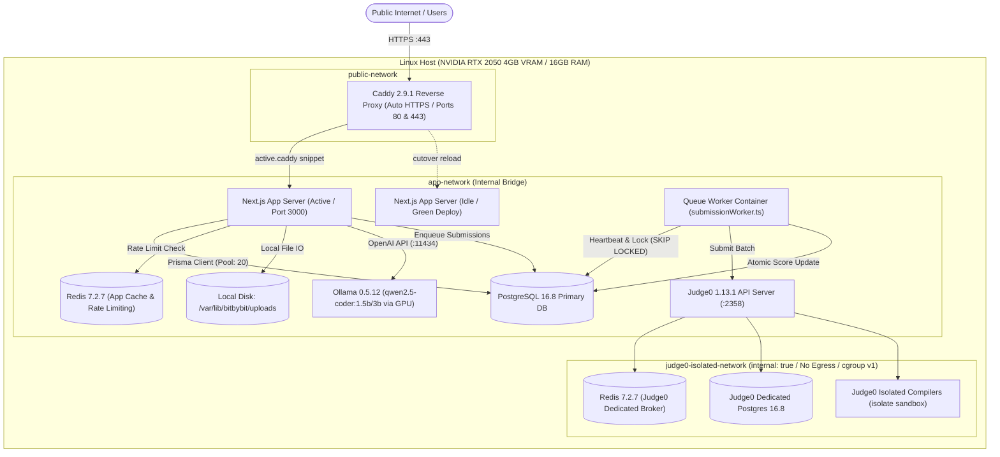
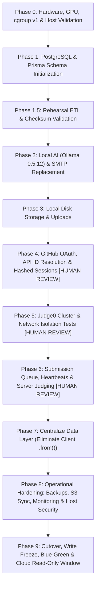

# BitByBit — Self-Hosted Migration Plan (Revised v4)

## Document Revision History & Change Log

The following comprehensive architectural updates and hardening decisions have been applied to this migration plan:

1. **Version Pinning & Citation of Sources**:
   - **Ollama**: `ollama/ollama:0.5.12` (checked against official Ollama GitHub release notes; official Qwen2.5-Coder support verified in $\ge$ 0.3.14).
   - **Node.js**: `node:22.14.0-alpine` (checked against Node.js 22 LTS "Jod" official release).
   - **Next.js**: `14.2.25` (pinned in `package.json`; includes security patch for **CVE-2025-29927**).
   - **Defense-in-Depth Auth**: Enforced session & permission checks inside **every Route Handler and Server Action directly**, treating `middleware.ts` purely as an edge pre-filter.
   - **PostgreSQL**: `postgres:16.8-alpine` (checked against PostgreSQL 16.8 official release notes).
   - **Redis**: `redis:7.2.7-alpine` (checked against Redis 7.2.7 LTS release notes).
   - **Caddy**: `caddy:2.9.1-alpine` (checked against Caddy v2.9.1 GitHub release).
2. **Zero-Downtime Blue-Green Deployment Engine (`scripts/deploy.sh`)**:
   - Migrations executed inside a dedicated temporary migration container (`docker compose run --rm app_deploy npx prisma migrate deploy`).
   - Dynamic upstream routing using an imported `/etc/caddy/active.caddy` snippet (eliminating fragile regex `sed` on the main Caddyfile).
   - Health checks executed over internal Docker network (`http://app_$TARGET_COLOR:3000/api/health`).
   - Automated active-color detection and 15-second graceful traffic drain delay before stopping the idle container.
3. **Robust Cutover, Write Freeze & DNS Cutover**:
   - Two-tier write freeze: application-level maintenance mode + database-level read-only permissions (`REVOKE INSERT, UPDATE, DELETE`).
   - DNS TTL reduction to 300s 72 hours prior to cutover.
   - Dedicated Razorpay webhook migration steps.
   - Old Vercel deployment retained in read-only mode for a 14-day safety window.
4. **GitHub ID Resolution & High-Risk Account Protection**:
   - Pre-migration ETL resolves numeric `githubId` directly via GitHub REST API (`https://api.github.com/users/:username`).
   - Fallback first-login binding reserved only for deleted/renamed accounts.
   - Mandatory manual verification required for `ADMIN` or $>1000$-point accounts if `githubId` cannot be resolved via API.
5. **Submission Queue, Heartbeats & Security Guardrails**:
   - `Submission.jobId` modeled with `@unique` constraint.
   - 10-second heartbeat mechanism on active workers; stuck reaper reclaims jobs where `lockedAt < NOW() - 30s`.
   - Total points recomputed strictly as the sum of `maxPoints` from `UserProblemBest` (canonical single source of truth).
   - Ownership verification on `GET /api/submissions/status/[jobId]`.
   - Max 64KB code size validation enforced before queue insertion.
6. **Server-Side Judging for Arena & Weekly Competitions**:
   - Full server-side judging extended to `ArenaSubmission` and `WeeklySubmission`.
   - Server-side time window enforcement and strike penalty calculations (`max(0.7, 1.0 - strikes * 0.1)`).
   - Best-attempt aggregation for contest leaderboards.
7. **Complete Network Isolation & Dedicated Redis Instances**:
   - Dedicated `redis_app` (rate limits, queue) and separate `redis_judge0` (Judge0 internal broker).
   - `judge0-isolated-network` configured with `internal: true` (strictly zero internet egress).
   - Automated sandbox egress failure test in Phase 5.
8. **Prisma Schema Normalization & Constraint Hardening**:
   - Removed stale denormalized columns (`github`, `name`, `problemTitle`, `contestName`) from child tables.
   - Added `@unique` constraints on `razorpayPaymentId` and `razorpayOrderId`.
   - Converted all remaining status/mode strings to strict Prisma Enums.
9. **ETL Enum Mapping & UserProblemBest Backfill**:
   - Explicit enum transformation dictionaries for legacy Supabase rows.
   - Automated backfill of `UserProblemBest` from historical `submissions`.
   - Source-to-target SQL validation suite with exact checksums.
10. **Host Hardening, Offsite Backups & Restore Verification**:
    - Automated daily `pg_dump` with S3 offsite synchronization (`rclone` / AWS CLI) and dry-run restore script (`scripts/test-restore.sh`).
    - UFW firewall, SSH key-only configuration, Docker daemon log rotation, and Caddy security headers.

---

## 1. Target Architecture & Infrastructure Topology



### 1.1 Docker Services & Version Pinning

| Service Name | Pinned Image Tag | Source & Verification Citation | Networks | Exposed Ports | Volumes & Persistence | Resource Limits |
|---|---|---|---|---|---|---|
| **`caddy`** | `caddy:2.9.1-alpine` | [Caddy v2.9.1 Release Notes](https://github.com/caddyserver/caddy/releases/tag/v2.9.1) | `public-network`, `app-network` | `80:80`, `443:443` | `caddy_data:/data`, `caddy_config:/config`, `./Caddyfile:/etc/caddy/Caddyfile`, `./active.caddy:/etc/caddy/active.caddy` | 0.5 CPU, 128 MB RAM |
| **`app_blue`** | `bitbybit-app:production` | Built from `node:22.14.0-alpine` (Node 22 LTS "Jod") + Next.js `14.2.25` | `app-network` | None (Internal `:3000`) | `app_uploads:/var/lib/bitbybit/uploads` | 2.0 CPU, 1 GB RAM |
| **`app_green`** | `bitbybit-app:production` | Built from `node:22.14.0-alpine` (Node 22 LTS "Jod") + Next.js `14.2.25` | `app-network` | None (Internal `:3000`) | `app_uploads:/var/lib/bitbybit/uploads` | 2.0 CPU, 1 GB RAM |
| **`worker`** | `bitbybit-app:production` | Built from `node:22.14.0-alpine` (Runs `submissionWorker.ts`) | `app-network` | None (Worker process) | `app_uploads:/var/lib/bitbybit/uploads` | 1.0 CPU, 512 MB RAM |
| **`postgres`** | `postgres:16.8-alpine` | [PostgreSQL 16.8 Official Release](https://www.postgresql.org/docs/release/16.8/) | `app-network` | None (Internal `:5432`) | `pgdata:/var/lib/postgresql/data`, `./backups:/backups` | 2.0 CPU, 2 GB RAM (Shared buffers: 512MB) |
| **`redis_app`** | `redis:7.2.7-alpine` | [Redis 7.2.7 Release Notes](https://raw.githubusercontent.com/redis/redis/7.2/00-RELEASENOTES) | `app-network` | None (Internal `:6379`) | `redis_app_data:/data` | 1.0 CPU, 512 MB RAM |
| **`ollama`** | `ollama/ollama:0.5.12` | [Ollama 0.5.12 Release Notes](https://github.com/ollama/ollama/releases/tag/v0.5.12) | `app-network` | None (Internal `:11434`) | `ollama_models:/root/.ollama` | 2.0 CPU, 4 GB RAM + NVIDIA RTX 2050 GPU |
| **`judge0_server`** | `judge0/judge0:1.13.1` | [Judge0 v1.13.1 Release](https://github.com/judge0/judge0/releases/tag/v1.13.1) | `app-network`, `judge0-isolated-network` | None (Internal `:2358`) | `./judge0.conf:/judge0.conf:ro` | 1.0 CPU, 512 MB RAM |
| **`judge0_workers`** | `judge0/judge0:1.13.1` | Judge0 v1.13.1 Isolated Sandbox | `judge0-isolated-network` (`internal: true`) | None | Privileged, `/sys/fs/cgroup:/sys/fs/cgroup:ro` | 4.0 CPU, 4 GB RAM |
| **`judge0_db`** | `postgres:16.8-alpine` | PostgreSQL 16.8 (Judge0 Dedicated) | `judge0-isolated-network` (`internal: true`) | None (Internal `:5432`) | `judge0_pgdata:/var/lib/postgresql/data` | 1.0 CPU, 512 MB RAM |
| **`redis_judge0`** | `redis:7.2.7-alpine` | Redis 7.2.7 (Judge0 Dedicated) | `judge0-isolated-network` (`internal: true`) | None (Internal `:6379`) | `judge0_redisdata:/data` | 1.0 CPU, 512 MB RAM |

---

## 2. Normalized PostgreSQL Schema (Prisma Models)

```prisma
datasource db {
  provider = "postgresql"
  url      = env("DATABASE_URL")
}

generator client {
  provider = "prisma-client-js"
}

// ── Enums ──────────────────────────────────────────────────────────

enum UserRole {
  USER
  ADMIN
}

enum Difficulty {
  Easy
  Medium
  Hard
}

enum ProblemVisibility {
  PUBLIC
  ARENA
  WEEKLY
}

enum JobStatus {
  QUEUED
  PROCESSING
  COMPLETED
  FAILED
}

enum JobMode {
  RUN
  SUBMIT
}

enum SubmissionStatus {
  PENDING
  APPROVED
  REJECTED
}

enum ContestStatus {
  UPCOMING
  LIVE
  ENDED
}

enum RegistrationStatus {
  PENDING
  CONFIRMED
  REJECTED
}

enum ArenaStatus {
  SUBMITTED
  DISQUALIFIED
  REVIEWED
}

enum SubscriberStatus {
  ACTIVE
  CONFIRMED
  PENDING
  EXPIRED
  CANCELLED
}

enum DiscountType {
  FIXED
  PERCENTAGE
}

enum CertificateStatus {
  ISSUED
  REVOKED
}

enum EmailDeliveryStatus {
  PENDING
  SENT
  FAILED
}

enum AiFeature {
  HINT
  EXPLAIN_FAILURE
  REVIEW_CODE
  VALIDATE_APPROACH
  EDITORIAL
  RECOMMENDATION
}

// ── Auth & Users (GitHub OAuth Only) ───────────────────────────────

model User {
  id             String    @id @default(uuid()) @db.Uuid
  githubId       String?   @unique @map("github_id")        // Numeric GitHub ID (e.g. "12345678")
  githubUsername String    @unique @map("github_username")  // Current GitHub handle
  name           String
  email          String?   @unique
  avatarUrl      String?   @map("avatar_url")
  role           UserRole  @default(USER)
  totalPoints    Int       @default(0) @map("total_points")
  problemsSolved Int       @default(0) @map("problems_solved")
  streak         Int       @default(0)
  lastSolvedAt   DateTime? @map("last_solved_at") @db.Timestamptz
  createdAt      DateTime  @default(now()) @map("created_at") @db.Timestamptz
  updatedAt      DateTime  @updatedAt @map("updated_at") @db.Timestamptz

  sessions             Session[]
  submissions          Submission[]
  userProblemBests     UserProblemBest[]
  submissionJobs       SubmissionJob[]
  contestRegistrations ContestRegistration[]
  arenaSubmissions     ArenaSubmission[]
  weeklyAccesses       WeeklyAccess[]
  weeklySubmissions    WeeklySubmission[]
  subscription         Subscriber?
  certificates         Certificate[]
  aiUsages             AiUsage[]
  practiceAttempts     PracticeAttempt[]

  @@index([githubUsername])
  @@index([githubId])
  @@index([role])
  @@index([totalPoints(sort: Desc)])
  @@map("users")
}

model Session {
  id         String   @id @default(uuid()) @db.Uuid
  userId     String   @map("user_id") @db.Uuid
  tokenHash  String   @unique @map("token_hash") // SHA-256 hash of random session secret
  expiresAt  DateTime @map("expires_at") @db.Timestamptz
  ipAddress  String?  @map("ip_address")
  userAgent  String?  @map("user_agent")
  createdAt  DateTime @default(now()) @map("created_at") @db.Timestamptz

  user User @relation(fields: [userId], references: [id], onDelete: Cascade)

  @@index([tokenHash])
  @@index([userId, expiresAt])
  @@map("sessions")
}

// ── Problems, Relational Test Cases & Join Tables ──────────────────

model Problem {
  id               String            @id @default(uuid()) @db.Uuid
  title            String
  slug             String            @unique
  difficulty       Difficulty
  points           Int               @default(100)
  tags             String[]          @default([])
  description      String            @db.Text
  example          String            @db.Text
  starterCode      String            @map("starter_code") @db.Text
  paramTypes       String[]          @map("param_types")
  returnType       String            @map("return_type")
  hints            String[]          @default([])
  submissionCount  Int               @default(0) @map("submission_count")
  isContestProblem Boolean           @default(false) @map("is_contest_problem")
  visibility       ProblemVisibility @default(PUBLIC)
  createdAt        DateTime          @default(now()) @map("created_at") @db.Timestamptz
  updatedAt        DateTime          @updatedAt @map("updated_at") @db.Timestamptz

  testCases               TestCase[]
  submissions             Submission[]
  userProblemBests        UserProblemBest[]
  submissionJobs          SubmissionJob[]
  contestProblems         ContestProblem[]
  arenaSubmissions        ArenaSubmission[]
  weeklyChallengeProblems WeeklyChallengeProblem[]
  weeklySubmissions       WeeklySubmission[]
  practiceAttempts        PracticeAttempt[]

  @@index([difficulty])
  @@index([visibility])
  @@map("problems")
}

model TestCase {
  id          String   @id @default(uuid()) @db.Uuid
  problemId   String   @map("problem_id") @db.Uuid
  input       String   @db.Text
  expected    String   @db.Text
  isHidden    Boolean  @default(false) @map("is_hidden")
  explanation String?  @db.Text
  orderIndex  Int      @default(0) @map("order_index")
  createdAt   DateTime @default(now()) @map("created_at") @db.Timestamptz

  problem Problem @relation(fields: [problemId], references: [id], onDelete: Cascade)

  @@index([problemId, isHidden, orderIndex])
  @@map("test_cases")
}

// ── Submission Queue & Execution Records ───────────────────────────

model SubmissionJob {
  id          String    @id @default(uuid()) @db.Uuid
  userId      String    @map("user_id") @db.Uuid
  problemId   String    @map("problem_id") @db.Uuid
  language    String
  code        String    @db.Text
  approach    String?   @db.Text
  mode        JobMode   @default(SUBMIT)
  status      JobStatus @default(QUEUED)
  priority    Int       @default(0)
  retryCount  Int       @default(0) @map("retry_count")
  lockedAt    DateTime? @map("locked_at") @db.Timestamptz
  lockedBy    String?   @map("locked_by")
  results     Json?
  error       String?   @db.Text
  createdAt   DateTime  @default(now()) @map("created_at") @db.Timestamptz
  completedAt DateTime? @map("completed_at") @db.Timestamptz

  user       User        @relation(fields: [userId], references: [id], onDelete: Cascade)
  problem    Problem     @relation(fields: [problemId], references: [id], onDelete: Cascade)
  submission Submission?

  @@index([status, priority(sort: Desc), createdAt(sort: Asc)])
  @@index([userId, status])
  @@index([lockedAt])
  @@map("submission_jobs")
}

model Submission {
  id            String           @id @default(uuid()) @db.Uuid
  jobId         String?          @unique @map("job_id") @db.Uuid
  problemId     String           @map("problem_id") @db.Uuid
  userId        String           @map("user_id") @db.Uuid
  lang          String
  code          String           @db.Text
  approach      String           @db.Text
  status        SubmissionStatus @default(PENDING)
  testsPassed   Int              @default(0) @map("tests_passed")
  testsTotal    Int              @default(0) @map("tests_total")
  pointsAwarded Int              @default(0) @map("points_awarded")
  executionMs   Int?             @map("execution_ms")
  memoryKb      Int?             @map("memory_kb")
  rejectReason  String?          @map("reject_reason")
  createdAt     DateTime         @default(now()) @map("created_at") @db.Timestamptz

  job     SubmissionJob? @relation(fields: [jobId], references: [id], onDelete: SetNull)
  problem Problem        @relation(fields: [problemId], references: [id], onDelete: Cascade)
  user    User           @relation(fields: [userId], references: [id], onDelete: Cascade)

  @@index([problemId, userId, createdAt(sort: Desc)])
  @@index([userId, createdAt(sort: Desc)])
  @@index([status])
  @@map("submissions")
}

model UserProblemBest {
  id               String    @id @default(uuid()) @db.Uuid
  userId           String    @map("user_id") @db.Uuid
  problemId        String    @map("problem_id") @db.Uuid
  bestSubmissionId String?   @map("best_submission_id") @db.Uuid
  maxPoints        Int       @default(0) @map("max_points")
  isSolved         Boolean   @default(false) @map("is_solved")
  firstSolvedAt    DateTime? @map("first_solved_at") @db.Timestamptz
  updatedAt        DateTime  @updatedAt @map("updated_at") @db.Timestamptz

  user    User    @relation(fields: [userId], references: [id], onDelete: Cascade)
  problem Problem @relation(fields: [problemId], references: [id], onDelete: Cascade)

  @@unique([userId, problemId], name: "unique_user_problem_best")
  @@index([userId, isSolved])
  @@map("user_problem_bests")
}

// ── Contests & Normalized Join Tables ──────────────────────────────

model Contest {
  id                  String        @id @default(uuid()) @db.Uuid
  name                String
  entryFee            Int           @default(0) @map("entry_fee")
  durationMins        Int           @map("duration_mins")
  upiId               String?       @map("upi_id")
  leaderboardDiscount Int           @default(0) @map("leaderboard_discount")
  status              ContestStatus @default(UPCOMING)
  startsAt            DateTime?     @map("starts_at") @db.Timestamptz
  createdAt           DateTime      @default(now()) @map("created_at") @db.Timestamptz

  contestProblems  ContestProblem[]
  registrations    ContestRegistration[]
  arenaSubmissions ArenaSubmission[]

  @@index([status, startsAt])
  @@map("contests")
}

model ContestProblem {
  id         String @id @default(uuid()) @db.Uuid
  contestId  String @map("contest_id") @db.Uuid
  problemId  String @map("problem_id") @db.Uuid
  orderIndex Int    @default(0) @map("order_index")
  points     Int    @default(100)

  contest Contest @relation(fields: [contestId], references: [id], onDelete: Cascade)
  problem Problem @relation(fields: [problemId], references: [id], onDelete: Cascade)

  @@unique([contestId, problemId], name: "unique_contest_problem")
  @@map("contest_problems")
}

model ContestRegistration {
  id                String             @id @default(uuid()) @db.Uuid
  contestId         String             @map("contest_id") @db.Uuid
  userId            String             @map("user_id") @db.Uuid
  txnId             String?            @map("txn_id")
  razorpayOrderId   String?            @unique @map("razorpay_order_id")
  razorpayPaymentId String?            @unique @map("razorpay_payment_id")
  status            RegistrationStatus @default(PENDING)
  createdAt         DateTime           @default(now()) @map("created_at") @db.Timestamptz

  contest Contest @relation(fields: [contestId], references: [id], onDelete: Cascade)
  user    User    @relation(fields: [userId], references: [id], onDelete: Cascade)

  @@unique([contestId, userId], name: "unique_contest_registration")
  @@index([userId])
  @@map("contest_registrations")
}

model ArenaSubmission {
  id                  String      @id @default(uuid()) @db.Uuid
  contestId           String      @map("contest_id") @db.Uuid
  problemId           String      @map("problem_id") @db.Uuid
  userId              String      @map("user_id") @db.Uuid
  lang                String
  code                String      @db.Text
  strikes             Int         @default(0)
  status              ArenaStatus @default(SUBMITTED)
  strikePenaltyFactor Float       @default(1.0) @map("strike_penalty_factor")
  pointsAwarded       Int         @default(0) @map("points_awarded")
  testsPassed         Int         @default(0) @map("tests_passed")
  testsTotal          Int         @default(0) @map("tests_total")
  createdAt           DateTime    @default(now()) @map("created_at") @db.Timestamptz

  contest Contest @relation(fields: [contestId], references: [id], onDelete: Cascade)
  problem Problem @relation(fields: [problemId], references: [id], onDelete: Cascade)
  user    User    @relation(fields: [userId], references: [id], onDelete: Cascade)

  @@index([contestId, problemId, userId])
  @@index([contestId, pointsAwarded(sort: Desc)])
  @@map("arena_submissions")
}

// ── Weekly Challenges & Normalized Join Tables ─────────────────────

model WeeklyChallenge {
  id           String   @id @default(uuid()) @db.Uuid
  title        String
  description  String   @db.Text
  entryFee     Int      @default(0) @map("entry_fee")
  upiId        String?  @map("upi_id")
  whatsappLink String?  @map("whatsapp_link")
  startsAt     DateTime @map("starts_at") @db.Timestamptz
  endsAt       DateTime @map("ends_at") @db.Timestamptz
  status       String   @default("active")
  createdAt    DateTime @default(now()) @map("created_at") @db.Timestamptz

  challengeProblems WeeklyChallengeProblem[]
  accesses          WeeklyAccess[]
  submissions       WeeklySubmission[]

  @@map("weekly_challenges")
}

model WeeklyChallengeProblem {
  id                String @id @default(uuid()) @db.Uuid
  weeklyChallengeId String @map("weekly_challenge_id") @db.Uuid
  problemId         String @map("problem_id") @db.Uuid
  orderIndex        Int    @default(0) @map("order_index")

  weeklyChallenge WeeklyChallenge @relation(fields: [weeklyChallengeId], references: [id], onDelete: Cascade)
  problem         Problem         @relation(fields: [problemId], references: [id], onDelete: Cascade)

  @@unique([weeklyChallengeId, problemId], name: "unique_weekly_problem")
  @@map("weekly_challenge_problems")
}

model WeeklyAccess {
  id                String   @id @default(uuid()) @db.Uuid
  weeklyChallengeId String   @map("weekly_challenge_id") @db.Uuid
  userId            String   @map("user_id") @db.Uuid
  txnId             String?  @map("txn_id")
  status            String   @default("confirmed")
  createdAt         DateTime @default(now()) @map("created_at") @db.Timestamptz

  weeklyChallenge WeeklyChallenge @relation(fields: [weeklyChallengeId], references: [id], onDelete: Cascade)
  user            User            @relation(fields: [userId], references: [id], onDelete: Cascade)

  @@unique([weeklyChallengeId, userId], name: "unique_weekly_access")
  @@map("weekly_access")
}

model WeeklySubmission {
  id                String   @id @default(uuid()) @db.Uuid
  weeklyChallengeId String   @map("weekly_challenge_id") @db.Uuid
  problemId         String   @map("problem_id") @db.Uuid
  userId            String   @map("user_id") @db.Uuid
  lang              String
  code              String   @db.Text
  status            String   @default("approved")
  testsPassed       Int      @default(0) @map("tests_passed")
  testsTotal        Int      @default(0) @map("tests_total")
  pointsAwarded     Int      @default(0) @map("points_awarded")
  submittedAt       DateTime @default(now()) @map("submitted_at") @db.Timestamptz
  createdAt         DateTime @default(now()) @map("created_at") @db.Timestamptz

  weeklyChallenge WeeklyChallenge @relation(fields: [weeklyChallengeId], references: [id], onDelete: Cascade)
  problem         Problem         @relation(fields: [problemId], references: [id], onDelete: Cascade)
  user            User            @relation(fields: [userId], references: [id], onDelete: Cascade)

  @@index([weeklyChallengeId, userId])
  @@map("weekly_submissions")
}

// ── Subscriptions & Coupons ────────────────────────────────────────

model Subscriber {
  id                String           @id @default(uuid()) @db.Uuid
  userId            String           @unique @map("user_id") @db.Uuid
  txnId             String?          @map("txn_id")
  razorpayOrderId   String?          @unique @map("razorpay_order_id")
  razorpayPaymentId String?          @unique @map("razorpay_payment_id")
  status            SubscriberStatus @default(ACTIVE)
  currentPeriodEnd  DateTime         @map("current_period_end") @db.Timestamptz
  createdAt         DateTime         @default(now()) @map("created_at") @db.Timestamptz

  user User @relation(fields: [userId], references: [id], onDelete: Cascade)

  @@index([status, currentPeriodEnd])
  @@map("subscribers")
}

model Coupon {
  id            String       @id @default(uuid()) @db.Uuid
  code          String       @unique
  discountType  DiscountType @default(FIXED) @map("discount_type")
  discountValue Decimal      @default(160) @map("discount_value") @db.Decimal(10, 2)
  isActive      Boolean      @default(true) @map("is_active")
  createdAt     DateTime     @default(now()) @map("created_at") @db.Timestamptz

  @@index([code, isActive])
  @@map("coupons")
}

// ── Certificates, Communications & Telemetry ───────────────────────

model Certificate {
  id                 String              @id @default(uuid()) @db.Uuid
  certificateId      String              @unique @map("certificate_id")
  userId             String?             @map("user_id") @db.Uuid
  recipientName      String              @map("recipient_name")
  recipientEmail     String              @map("recipient_email")
  certificateType    String              @default("Certificate of Achievement") @map("certificate_type")
  title              String              @default("CERTIFICATE OF ACHIEVEMENT")
  achievementText    String              @map("achievement_text") @db.Text
  eventName          String              @map("event_name")
  organizationText   String              @default("from teamcodelocked club") @map("organization_text")
  activityPointsText String?             @map("activity_points_text")
  coordinatorNames   Json                @default("[]") @map("coordinator_names")
  issuedAt           DateTime            @default(now()) @map("issued_at") @db.Timestamptz
  issuedBy           String              @map("issued_by")
  pdfPath            String              @map("pdf_path")
  status             CertificateStatus   @default(ISSUED)
  emailStatus        EmailDeliveryStatus @default(PENDING) @map("email_status")
  emailError         String?             @map("email_error")
  createdAt          DateTime            @default(now()) @map("created_at") @db.Timestamptz
  updatedAt          DateTime            @updatedAt @map("updated_at") @db.Timestamptz

  user User? @relation(fields: [userId], references: [id], onDelete: SetNull)

  @@index([certificateId])
  @@index([userId])
  @@map("certificates")
}

model EmailLog {
  id     String   @id @default(uuid()) @db.Uuid
  email  String
  kind   String
  refId  String   @map("ref_id")
  sentAt DateTime @default(now()) @map("sent_at") @db.Timestamptz

  @@index([email, kind, refId])
  @@map("email_log")
}

model AiUsage {
  id         String    @id @default(uuid()) @db.Uuid
  userId     String    @map("user_id") @db.Uuid
  feature    AiFeature
  problemId  String    @default("") @map("problem_id")
  used       Int       @default(1)
  date       DateTime  @db.Date
  lastUsedAt DateTime? @map("last_used_at") @db.Timestamptz

  user User @relation(fields: [userId], references: [id], onDelete: Cascade)

  @@unique([userId, feature, problemId, date], name: "unique_ai_usage_day")
  @@index([userId, date])
  @@map("ai_usage")
}

model PracticeAttempt {
  id          String   @id @default(uuid()) @db.Uuid
  problemId   String   @map("problem_id") @db.Uuid
  userId      String   @map("user_id") @db.Uuid
  lang        String
  attemptedAt DateTime @default(now()) @map("attempted_at") @db.Timestamptz

  problem Problem @relation(fields: [problemId], references: [id], onDelete: Cascade)
  user    User    @relation(fields: [userId], references: [id], onDelete: Cascade)

  @@index([problemId, userId])
  @@map("practice_attempts")
}

model AppConfig {
  key   String @id
  value String

  @@map("app_config")
}

model CollaborationPage {
  id        String   @id @default(uuid()) @db.Uuid
  title     String   @default("Our Collaborations")
  content   String   @db.Text
  updatedAt DateTime @default(now()) @updatedAt @map("updated_at") @db.Timestamptz

  @@map("collaborations_page")
}
```

---

## 3. Ordered Migration Phases



---

### Phase 0: Hardware, GPU, cgroup v1 & Tooling Setup
* **Goal**: Validate local Docker environment, verify NVIDIA GPU passthrough for Ollama, confirm cgroup v1 kernel settings for Judge0, and establish test scripts.
* **Changes**:
  - Create `docker-compose.yml` with pinned images: `postgres:16.8-alpine`, `redis:7.2.7-alpine`, `caddy:2.9.1-alpine`, `ollama/ollama:0.5.12` (GPU passthrough for RTX 2050), and Judge0 cluster.
  - Create `scripts/check.sh` (linting, typechecks, schema checks).
* **Automated Verification Tests**:
  1. **GPU Passthrough Validation**:
     ```bash
     docker run --rm --gpus all nvidia/cuda:12.4.1-base-ubuntu22.04 nvidia-smi
     ```
     *Expected*: Outputs RTX 2050 driver state, 4 GB VRAM allocation, and CUDA 12.x support.
  2. **cgroup v1 Verification for Judge0**:
     ```bash
     docker run --rm -v /sys/fs/cgroup:/sys/fs/cgroup:ro alpine sh -c "ls -d /sys/fs/cgroup/cpu /sys/fs/cgroup/memory /sys/fs/cgroup/pids"
     ```
     *Expected*: Lists legacy cgroup controllers without error.
  3. **Ollama GPU Inference Verification**:
     ```bash
     docker compose up -d ollama
     docker compose exec ollama ollama run qwen2.5-coder:1.5b "print('GPU ready')"
     ```
     *Expected*: Completes inference in $< 1.5$ seconds using GPU VRAM.
  4. **Code Quality Script**: `bash scripts/check.sh` $\rightarrow$ passes.
* **Rollback**: `docker compose down -v`.

---

### Phase 1: PostgreSQL & Prisma ORM Schema Initialization
* **Goal**: Establish normalized target schema in PostgreSQL using Prisma with strict join tables, enums, and foreign-key constraints.
* **Changes**:
  - Create `prisma/schema.prisma` matching Section 2.
  - Generate initial Prisma migration: `npx prisma migrate dev --name init`.
  - Create database client singleton `src/lib/prisma.ts` on Node.js 22 LTS.
* **Files Touched**:
  - `prisma/schema.prisma` (New)
  - `prisma/migrations/*` (New)
  - `src/lib/prisma.ts` (New)
* **Testing & Verification**:
  - `npx prisma migrate deploy` executes cleanly on PostgreSQL 16.8.
  - `npx prisma studio` connects and displays all 20 models.
* **Rollback**: `npx prisma migrate reset`.

---

### Phase 1.5: Rehearsal Data Migration (Dry-Run)
* **Goal**: Validate extraction, transformation, join-table population, and count/checksum verification without affecting production.
* **Changes**:
  - Implement `scripts/migrate-supabase-to-postgres.ts`.
  - Implement `scripts/verify-data-integrity.ts`.
  - Run rehearsal ETL from Supabase staging/dump to local PostgreSQL.
* **Files Touched**:
  - `scripts/migrate-supabase-to-postgres.ts` (New)
  - `scripts/verify-data-integrity.ts` (New)
* **Testing & Verification**:
  - Execute `npx tsx scripts/migrate-supabase-to-postgres.ts --dry-run`.
  - Execute `npx tsx scripts/verify-data-integrity.ts` $\rightarrow$ validates:
    - `COUNT(members) == COUNT(users)`
    - `COUNT(problems) == COUNT(problems)`
    - `COUNT(test_cases) == SUM(jsonb_array_length(problems.test_cases))`
    - `SUM(submissions.points_awarded) == SUM(submissions.points_awarded)`
* **Rollback**: `npx prisma migrate reset`.

---

### Phase 2: Local AI (Ollama) & Self-Hosted SMTP Replacement
* **Goal**: Replace Groq Cloud API with local `qwen2.5-coder:1.5b` or `3b` (`ollama/ollama:0.5.12`) and Brevo with Nodemailer SMTP relay.
* **Changes**:
  - Create `src/lib/ai/client.ts` pointing to `http://ollama:11434/v1` (OpenAI compatible).
  - Update `src/lib/email.ts` to use `nodemailer` with standard SMTP relay.
  - Update `src/app/api/ai/route.ts` to use `src/lib/ai/client.ts`.
* **Files Touched**:
  - `src/lib/ai/client.ts` (New)
  - `src/lib/email.ts`
  - `src/app/api/ai/route.ts`
* **Testing & Verification**:
  - POST to `/api/ai` with a test prompt $\rightarrow$ returns AI response from local GPU within 1.5 seconds.
  - Send email via `src/lib/email.ts` $\rightarrow$ arrives in local SMTP inbox (e.g. Mailpit).
* **Rollback**: Toggle `USE_LOCAL_AI=false` and `USE_LOCAL_SMTP=false` in `.env`.

---

### Phase 3: Local Disk Storage & Asset Management
* **Goal**: Replace Supabase Storage with local filesystem volume (`/var/lib/bitbybit/uploads`).
* **Changes**:
  - Create storage module `src/lib/storage.ts` using Node.js `fs/promises` writing to `/var/lib/bitbybit/uploads`.
  - Refactor `/api/admin/upload-image` and `/api/certificates/issue` to save directly to local volume.
  - Refactor `/api/images/[...path]` to stream files from disk with proper MIME headers and caching.
* **Files Touched**:
  - `src/lib/storage.ts` (New)
  - `src/app/api/admin/upload-image/route.ts`
  - `src/app/api/certificates/issue/route.ts`
  - `src/app/api/images/[...path]/route.ts`
* **Testing & Verification**:
  - Upload image in admin panel $\rightarrow$ file saved to `/var/lib/bitbybit/uploads/problem-images/` and accessible at `/api/images/...`.
  - Generate certificate PDF $\rightarrow$ saved to `/var/lib/bitbybit/uploads/certificates/`.
* **Rollback**: Revert storage paths in `src/lib/storage.ts`.

---

### Phase 4: Self-Hosted GitHub OAuth, API ID Resolution & Hashed Sessions **[NEEDS HUMAN REVIEW]**
> [!IMPORTANT]
> **Needs Human Review**: Replaces Supabase Auth. Implements direct GitHub OAuth 2.0 PKCE, session generation with SHA-256 token hashing, and HTTP-only cookies.

* **Goal**: Complete self-hosted GitHub OAuth authentication with secure cookie sessions, pre-migration GitHub API numeric ID resolution, and OAuth `state` CSRF mitigation.
* **Pre-Migration GitHub API Numeric ID Resolution**:
  1. During ETL migration (`scripts/migrate-supabase-to-postgres.ts`), query GitHub API `GET https://api.github.com/users/:username` (using authenticated `GITHUB_TOKEN`).
  2. Populate `User.githubId = String(data.id)`.
  3. **High-Risk Account Safety Guard**: If an account has `role === ADMIN` or `totalPoints >= 1000` and its `githubId` cannot be resolved automatically via GitHub API (e.g. user deleted or renamed their account), flag the account as `requires_admin_verification = true`. Prohibit automatic first-login binding for that account until confirmed by a system admin.
  4. **Fallback Binding**: For standard unverified accounts, bind `githubId` on their first successful OAuth login.
* **OAuth CSRF State Parameter Protection**:
  - Login initiates at `GET /api/auth/github`: generates random 32-byte cryptographic nonce, signs it via HMAC-SHA256, and stores in HTTP-only `oauth_state` cookie (TTL: 10 mins).
  - Callback at `GET /api/auth/callback`: verifies `req.query.state === cookie.oauth_state`. Rejects mismatched state with HTTP 403.
* **Changes**:
  - Implement `src/lib/auth/github.ts` (OAuth flow, profile retrieval, state verification).
  - Implement `src/lib/auth/session.ts` (generates random 32-byte secret, stores `crypto.createHash('sha256').update(secret).digest('hex')` in `sessions` table, sets HTTP-only `bb_session` cookie).
  - Create API routes: `GET /api/auth/github`, `GET /api/auth/callback`, `POST /api/auth/logout`, `GET /api/auth/me`.
  - Implement `src/middleware.ts` for session verification.
* **Files Touched**:
  - `src/lib/auth/github.ts`, `src/lib/auth/session.ts` (New)
  - `src/app/api/auth/*` (New)
  - `src/middleware.ts` (New)
* **Testing & Verification**:
  - Click "Sign in with GitHub" $\rightarrow$ verifies `state` token, completes callback, binds `githubId`, sets `bb_session` cookie.
  - Database verification: `sessions` table contains `token_hash` (raw token is never stored).
  - `/api/auth/me` returns current user object with verified admin role.
* **Rollback**: Revert `src/middleware.ts` and auth API routes.

---

### Phase 5: Self-Hosted Judge0 Sandbox & cgroup Configuration **[NEEDS HUMAN REVIEW]**
> [!IMPORTANT]
> **Needs Human Review**: Sandboxed execution of arbitrary user code. Must verify cgroups isolation and network isolation on Linux host.

* **Goal**: Configure Judge0 v1.13.1 on `judge0-isolated-network` (`internal: true`) with cgroup v1 compatibility and build client wrapper in `src/judge/`.
* **cgroup Verification & Host Setup**:
  - Judge0 v1.13.1 isolate sandbox requires **cgroup v1** controllers (`cpu`, `memory`, `pids`).
  - On Linux host using cgroup v2 (Ubuntu 22.04+): configure kernel parameter in `/etc/default/grub`:
    ```bash
    GRUB_CMDLINE_LINUX="systemd.unified_cgroup_hierarchy=0"
    sudo update-grub && sudo reboot
    ```
  - Mount `/sys/fs/cgroup` into `judge0_workers` container.
* **Network Isolation Test**:
  - Submit program attempting outbound network connection:
    ```python
    import socket
    s = socket.socket(socket.AF_INET, socket.SOCK_STREAM)
    s.settimeout(2)
    s.connect(('1.1.1.1', 80))
    ```
  - *Expected*: Fails immediately with `OSError: [Errno 101] Network is unreachable`.
* **Changes**:
  - Create `src/judge/client.ts` and `src/judge/types.ts`.
  - Remove Pyodide in-browser execution from `src/lib/browserExecutor.ts` and remove Wandbox fallback from `src/lib/executor.ts`.
  - Route **all 6 languages** (Python, JavaScript, C++, Java, Go, Rust) directly through `src/judge/client.ts`.
* **Files Touched**:
  - `src/judge/client.ts`, `src/judge/types.ts`, `src/judge/index.ts` (New)
  - `src/lib/executor.ts`
  - `src/lib/browserExecutor.ts` (Deprecated/Removed)
* **Testing & Verification**:
  - Execute test suite across Python, JS, C++, Java, Rust, and Go $\rightarrow$ all compile and return JSON output via Judge0.
  - Security check: Submit code attempting socket connections or filesystem access $\rightarrow$ isolate blocks connection with non-zero exit code.
* **Rollback**: Restart Judge0 containers with relaxed timeouts in `judge0.conf`.

---

### Phase 6: Server Judging, Hidden Test Cases, Queue Worker & Competition Scoring **[NEEDS HUMAN REVIEW]**
> [!IMPORTANT]
> **Needs Human Review**: Fixes CRIT-1 & CRIT-2. All test cases evaluated server-side. Implements queue worker, per-user rate limits, stuck-job reaper, and server-side Arena/Weekly judging.

* **Goal**: Implement resilient PostgreSQL submission queue (`submission_jobs`), separate `worker` container, Redis rate limiter, hidden test-case protection, and full server-side judging for practice, Arena, and Weekly competitions.
* **Queue & Worker Architecture**:
  1. **Rate Limiter & Guardrails (`src/lib/queue/rateLimiter.ts`)**:
     - Max 64KB source code payload limit (rejects payload $> 64$KB with HTTP 413).
     - "Run" mode: Max 10 runs per minute per user.
     - "Submit" mode: Max 3 submits per minute per user.
     - Max active jobs cap: Rejects new jobs if user already has 2 jobs in `QUEUED` or `PROCESSING`.
     - Load shedding: If total queued jobs > 100, temporarily rejects non-subscriber "Run" requests with HTTP 429.
  2. **Worker Process & Heartbeat Locking (`src/lib/queue/submissionWorker.ts`)**:
     - Polls `submission_jobs` using `SELECT ... FOR UPDATE SKIP LOCKED` every 500ms.
     - Emits a heartbeat updating `lockedAt = NOW()` every 10 seconds during long test runs.
     - Submits batched test cases to Judge0.
     - Sanitizes results (replaces hidden test inputs/outputs with `[Hidden]`).
     - Inside a single atomic database transaction (`prisma.$transaction`):
       - Inserts record into `submissions` linked via `Submission.jobId`.
       - Updates `user_problem_bests` (updates max points, first solve timestamp).
       - Recomputes `total_points` on `User` strictly as `SUM(user_problem_bests.maxPoints)` (eliminating point drift).
       - Updates `submission_jobs` status to `COMPLETED`.
  3. **Arena & Weekly Server-Side Judging Engine**:
     - **Arena Contest Verification**: Checks `contests.status === LIVE` and `NOW() <= contests.startsAt + durationMins`. Verifies active `ContestRegistration`.
     - **Server Strikes Calculation**: Detects tab switches / fullscreen exits sent by client, records strikes on server, and applies `strikePenaltyFactor = max(0.7, 1.0 - strikes * 0.1)`.
     - **Weekly Challenge Verification**: Checks active subscription or `weekly_access` record. Evaluates score and records submission in `weekly_submissions`.
  4. **Stuck-Job Reaper (`src/lib/queue/reaper.ts`)**:
     - Scans every 30s for jobs with `status = PROCESSING` and `lockedAt < NOW() - 30 seconds`.
     - Resets stuck jobs for retry (up to 3 retries), then marks as `FAILED`.
  5. **API Endpoints**:
     - `POST /api/execute`: Validates auth session, checks rate limits, enqueues job, returns `{ jobId }`.
     - `GET /api/submissions/status/[jobId]`: Verifies `job.userId === session.userId` or `session.user.role === ADMIN`, returns poll status and sanitized results.
     - `GET /api/problems/[id]`: Returns problem with hidden test cases stripped for non-admins.
* **Files Touched**:
  - `src/lib/queue/rateLimiter.ts`, `src/lib/queue/submissionWorker.ts`, `src/lib/queue/reaper.ts` (New)
  - `src/app/api/execute/route.ts`
  - `src/app/api/submissions/status/[jobId]/route.ts` (New)
  - `src/app/api/problems/[id]/route.ts`
  - `src/app/problems/Workspace.tsx`
* **Testing & Verification**:
  - Click "Run" $\rightarrow$ Polling completes in < 2s, returns sample results.
  - Click "Submit" $\rightarrow$ Evaluates against all test cases, records score in database, updates profile.
  - Check browser network tab $\rightarrow$ Zero hidden test inputs or expected outputs present in network payloads.
  - Simulate worker crash $\rightarrow$ Stuck job reaper reclaims and finishes job within 30 seconds.
* **Rollback**: Revert `Workspace.tsx` and worker polling routes.

---

### Phase 7: Client Query Refactoring & Centralized Data Layer
* **Goal**: Remove all client-side `@supabase/supabase-js` calls. Route all UI pages through Next.js Server Actions and Prisma.
* **Changes**:
  - Create Server Actions in `src/app/actions/`:
    - `leaderboard.ts` (aggregates rankings from `user_problem_bests` with server pagination).
    - `problems.ts` (filters, tags, user solve status).
    - `contests.ts` (contest entry, arena submissions).
    - `weekly.ts` (weekly challenges and submissions).
    - `profile.ts` (heatmap data, solved history).
    - `coupons.ts` (strictly verified admin coupon management).
  - Update all components in `src/components/pages/*` to use Server Actions.
  - Remove `@supabase/supabase-js` and `@supabase/ssr` from `package.json`.
* **Files Touched**:
  - `src/app/actions/*` (New)
  - `src/components/pages/*`
  - `src/lib/supabase.ts` (Deleted)
  - `package.json`
* **Testing & Verification**:
  - `grep -r "@supabase" src/` $\rightarrow$ 0 results.
  - Run full platform smoke test across all routes (Problems, Leaderboard, Arena, Weekly, Profile, Admin).
* **Rollback**: Restore `src/lib/supabase.ts` and revert actions.

---

### Phase 8: Operational Hardening: Backups, S3 Sync, Monitoring & Host Security
* **Goal**: Establish automated backup scripts with offsite sync, restore tests, healthcheck monitoring, CI static validation, and host security.
* **Host Setup & Secrets Hardening**:
  - Configure `.env.production` file permissions on Linux host:
    ```bash
    chmod 600 .env.production
    chown bitbybit:bitbybit .env.production
    ```
  - Configure UFW Firewall:
    ```bash
    sudo ufw default deny incoming
    sudo ufw default allow outgoing
    sudo ufw allow 22/tcp
    sudo ufw allow 80/tcp
    sudo ufw allow 443/tcp
    sudo ufw enable
    ```
  - Configure Docker Daemon Log Rotation (`/etc/docker/daemon.json`):
    ```json
    {
      "log-driver": "json-file",
      "log-opts": {
        "max-size": "50m",
        "max-file": "5"
      }
    }
    ```
* **Offsite Backup & Restore Verification (`scripts/backup.sh` and `scripts/test-restore.sh`)**:
  ```bash
  #!/bin/bash
  # scripts/backup.sh
  set -e
  DATE=$(date +%F_%H%M%S)
  BACKUP_FILE="/backups/bitbybit_db_${DATE}.sql.gz"

  # 1. Take pg_dump
  docker compose exec -T postgres pg_dump -U postgres bitbybit | gzip > "$BACKUP_FILE"

  # 2. Copy off-machine to S3/remote storage
  rclone copy "$BACKUP_FILE" remote:bitbybit-backups/database/

  # 3. Rotate local backups (keep 30 days)
  find /backups -name "bitbybit_db_*.sql.gz" -mtime +30 -delete
  ```
* **Restore Test Script (`scripts/test-restore.sh`)**:
  - Automatically loads latest `.sql.gz` dump into a temporary test database container and asserts non-zero table counts.
* **Caddy Production Security Headers (`Caddyfile`)**:
  ```caddy
  (security_headers) {
      header {
          Strict-Transport-Security "max-age=31536000; includeSubDomains; preload"
          X-Content-Type-Options "nosniff"
          X-Frame-Options "DENY"
          Referrer-Policy "strict-origin-when-cross-origin"
          Permissions-Policy "camera=(), microphone=(), geolocation=()"
          -Server
      }
  }
  ```
* **Files Touched**:
  - `scripts/backup.sh`, `scripts/test-restore.sh` (New)
  - `src/app/api/health/route.ts` (New)
  - `.github/workflows/ci.yml` (New)
  - `Caddyfile`
* **Testing & Verification**:
  - `bash scripts/backup.sh` $\rightarrow$ creates `.sql.gz` and copies to offsite destination.
  - `bash scripts/test-restore.sh` $\rightarrow$ restores dump in isolated test container and validates row counts.
  - `curl http://localhost:3000/api/health` $\rightarrow$ returns `{ status: "healthy", db: true, redis: true, queueDepth: 0 }`.
* **Rollback**: Delete CI workflow file.

---

### Phase 9: Production Cutover, Write Freeze, Blue-Green & Cloud Read-Only Window

#### Step 1: Pre-Cutover Preparation (T-72 Hours)
1. **Reduce DNS TTL**: Lower domain DNS TTL from 86400s (24h) to **300s (5 minutes)**.
2. **Staging Dry Run**: Run `scripts/migrate-supabase-to-postgres.ts` against staging environment and confirm 100% integrity.
3. **Razorpay Webhook Registration**: Add self-hosted endpoint `https://bitbybit.club/api/razorpay/webhook` in Razorpay Dashboard.

#### Step 2: Write Freeze & Final Incremental Sync (Cutover Window)
1. Enable global maintenance mode banner on old Vercel frontend.
2. **Execute Database Write Freeze**: Revoke write permissions on Supabase PostgreSQL:
   ```sql
   REVOKE INSERT, UPDATE, DELETE ON ALL TABLES IN SCHEMA public FROM anon, authenticated;
   ```
3. Run final incremental data sync script:
   ```bash
   npx tsx scripts/migrate-supabase-to-postgres.ts --final-cutover
   ```
4. Run automated integrity verification:
   ```bash
   npx tsx scripts/verify-data-integrity.ts
   ```

#### Step 3: Zero-Downtime Blue-Green Deployment Script (`scripts/deploy.sh`)

```bash
#!/bin/bash
set -e

# Auto-detect active color from active.caddy
if grep -q "app_blue:3000" /etc/caddy/active.caddy; then
  CURRENT_COLOR="blue"
  TARGET_COLOR="green"
  TARGET_PORT="3001"
else
  CURRENT_COLOR="green"
  TARGET_COLOR="blue"
  TARGET_PORT="3000"
fi

echo "=== Starting Zero-Downtime Deploy ==="
echo "Active: app_$CURRENT_COLOR | Deploying Target: app_$TARGET_COLOR (Port $TARGET_PORT)"

# 1. Run migrations inside a temporary migration container BEFORE starting new app
echo "--- Running Prisma Migrations ---"
docker compose run --rm app_blue npx prisma migrate deploy

# 2. Build and boot target color container
echo "--- Building and starting app_$TARGET_COLOR ---"
docker compose build "app_$TARGET_COLOR"
docker compose up -d --no-deps "app_$TARGET_COLOR"

# 3. Health check over internal Docker network
echo "--- Running Health Check on app_$TARGET_COLOR ---"
HEALTHY=false
for i in {1..30}; do
  if docker compose exec -T caddy wget -qO- "http://app_$TARGET_COLOR:3000/api/health" | grep -q '"status":"healthy"'; then
    HEALTHY=true
    echo "Health check passed!"
    break
  fi
  echo "Waiting for app_$TARGET_COLOR to become healthy ($i/30)..."
  sleep 2
done

if [ "$HEALTHY" = false ]; then
  echo "ERROR: Health check failed on app_$TARGET_COLOR! Aborting deployment."
  docker compose stop "app_$TARGET_COLOR"
  exit 1
fi

# 4. Switch Caddy upstream via active.caddy snippet
echo "--- Switching Caddy upstream to app_$TARGET_COLOR ---"
echo "reverse_proxy app_$TARGET_COLOR:3000" > ./active.caddy
docker compose exec -T caddy caddy reload --config /etc/caddy/Caddyfile

# 5. Graceful Drain Delay before stopping old container
echo "--- Draining in-flight connections on app_$CURRENT_COLOR (15s delay) ---"
sleep 15

# 6. Stop previous color
echo "--- Stopping app_$CURRENT_COLOR ---"
docker compose stop "app_$CURRENT_COLOR"

echo "=== Deployment successful: app_$TARGET_COLOR is now active ==="
```

#### Step 4: 14-Day Cloud Read-Only Archive Window & Rollback Strategy
* The previous Vercel deployment and Supabase database remain in **Read-Only Mode for 14 days**.
* If a critical unrecoverable issue arises within 24 hours:
  1. Point DNS or Caddy back to the Vercel deployment.
  2. Unfreeze Supabase permissions (`GRANT ALL ON ALL TABLES IN SCHEMA public TO authenticated, anon;`).
* **Emergency Reverse-Sync Tooling (`scripts/reverse-sync.ts`)**:
  - If users created submissions during the cutover window before rollback, `scripts/reverse-sync.ts` queries self-hosted PostgreSQL for records created after `CUTOVER_TIMESTAMP` and inserts them into Supabase via service-role key.
  - *Risks*: Schema differences (join tables $\rightarrow$ JSON array de-normalization) and non-atomic cross-database network transactions.

---

## 4. Phase Verification Quality Gates

Every phase must satisfy this verification checklist before advancing:

```markdown
### Quality Gate Checklist (Phase N)
- [ ] 1. All unit and integration tests pass: `npm test`
- [ ] 2. Static lint check passes: `npm run lint`
- [ ] 3. TypeScript compilation succeeds on Node 22 LTS: `npx tsc --noEmit`
- [ ] 4. Automated verification script passes: `bash scripts/check.sh`
- [ ] 5. Backward compatibility verified (no unhandled breaking schema changes)
- [ ] 6. If flagged [HUMAN REVIEW]: Security diff reviewed for auth, sandbox isolation, or hidden test cases
- [ ] 7. Git commit tagged: `git tag phase-N-complete`
```
